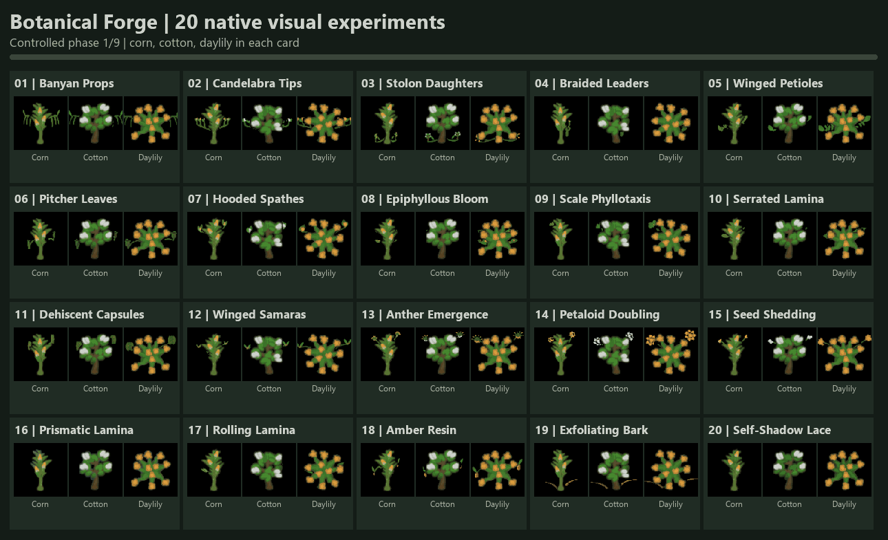

# Botanical Forge: twenty native visual experiments

## Animated comparison galleries

- [01-05: Unusual growth architectures](group-01.gif)
- [06-10: Novel botanical organs](group-02.gif)
- [11-15: Reproductive mechanisms](group-03.gif)
- [16-20: Unusual tissue properties](group-04.gif)

## Individual GIFs

- [01 Banyan Props](01-banyan-props.gif)
- [02 Candelabra Tips](02-candelabra-tips.gif)
- [03 Stolon Daughters](03-stolon-daughters.gif)
- [04 Braided Leaders](04-braided-leaders.gif)
- [05 Winged Petioles](05-winged-petioles.gif)
- [06 Pitcher Leaves](06-pitcher-leaves.gif)
- [07 Hooded Spathes](07-hooded-spathes.gif)
- [08 Epiphyllous Bloom](08-epiphyllous-bloom.gif)
- [09 Scale Phyllotaxis](09-scale-phyllotaxis.gif)
- [10 Serrated Lamina](10-serrated-lamina.gif)
- [11 Dehiscent Capsules](11-dehiscent-capsules.gif)
- [12 Winged Samaras](12-winged-samaras.gif)
- [13 Anther Emergence](13-anther-emergence.gif)
- [14 Petaloid Doubling](14-petaloid-doubling.gif)
- [15 Seed Shedding](15-seed-shedding.gif)
- [16 Prismatic Lamina](16-prismatic-lamina.gif)
- [17 Rolling Lamina](17-rolling-lamina.gif)
- [18 Amber Resin](18-amber-resin.gif)
- [19 Exfoliating Bark](19-exfoliating-bark.gif)
- [20 Self-Shadow Lace](20-self-shadow-lace.gif)

All GIFs contain nine native RimWorld GPU material readbacks per specimen,
played forward and back as a 16-frame loop. Controls are matching original
species artwork at identical pixel scale. These are off-screen material
previews from actual accepted live specimen materials, not map screenshots.
Wind is frozen only in the preview copy. Phase is a controlled test
uniform rather than naturally elapsed growth or simulated weather.
The optical effects approximate thin-film color and projected shadows;
they are not physical light transport. Seed shedding and daughter
rosettes are decorative, not actual seed drops or new spawned plants.

## Verification

Native run f4d9fa7e768449bd9fbd1df650a8ef14, source
[e03e761](https://github.com/lanwoodall423/Horticulture---Novel-Seeds/commit/e03e76122a0d8346ab4e526f77a4d8610fff150c),
AllPerformance loadout, RimWorld 1.7.5014 rev1195.

All 39 stages passed, 36 garden panels, 72 distinct live plants (60
modified, 12 controls), 540 accepted native material/phase samples and
540 GPU readbacks, 60 matching original-art GPU controls. All 60 modified
specimens had nine distinct rendered frames. 160 prepared atlases from
eight shared source maps. No additional mesh planes. Eighteen additive
modes retain every originally occupied source pixel exactly in atlas
preparation; the two optical modes preserve alpha and change only
classified green foliage. Maximum normalized direct interior-source RGB
error for additive modes 0.00008652791; optical modes 0.04706238.
Orientation assertions passed. Both builds and regression tests passed.
Normal saves, preferences, configuration unchanged; isolated package
and process removed.

[Native materials](native-materials.tsv) |
[GPU frames and pixel checks](native-gpu-frames.tsv) |
[Atlas preparation](atlas-preparation.tsv) |
[Phenotype descriptions](phenotypes.tsv) |
[Frame diversity](distinct-frames.json) |
[GIF manifest](gif-manifest.json) |
[Raw GPU images](frames/) |
[Preservation](preservation.json).

All twenty are zero-weight cosmetic candidates in a separate experimental
mode. Native map materials are accepted but full-map appearance, actual
growth activation, dense-field performance, save/reload and genetic
combinations remain unqualified. The 1.5x canvas and corresponding plane
are bounded, with a 192 MiB atlas allocation budget in this family;
the additional structures can look stylized and source-dependent.
Previous visual modes remain separate. The phase number in the human
readable log counts across gardens; the actual tested material phase
resets to 0..1 for each group and is recorded in native-materials.tsv.
