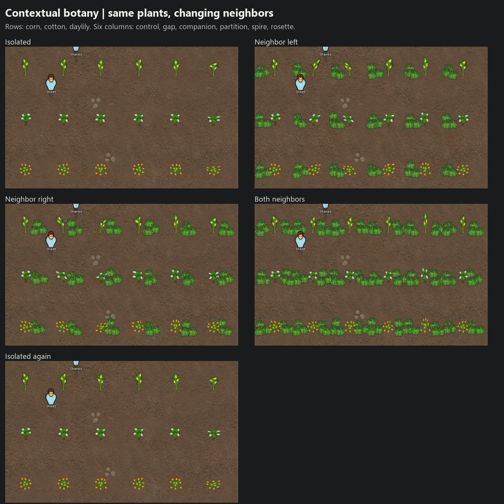

# Contextual botany: architecture responds to neighbors

Native RimWorld 1.7.5014 rev1195, AllPerformance loadout, run
f03590d1af094b39b3936df7d7ed16af, source
[99b63255c43164083ede53c7d906f3c742e4f42c](https://github.com/lanwoodall423/Horticulture---Novel-Seeds/commit/99b63255c43164083ede53c7d906f3c742e4f42c).

[Corn comparison](context-corn.jpg) | [Cotton comparison](context-cotton.jpg) |
[Daylily comparison](context-daylily.jpg).

In each species row, the same six plants persist through five states:
vanilla control, Gap Seeker, Companion Bow, Crown Partition, Stand Spire
and Free Rosette. The surrounding rice plants are actual spawned
neighbors, added or removed between captures. Roots stay anchored and
architecture returns to its original shape when neighbors are removed.

Original screenshots: [Isolated](panel-1.png) | [Left](panel-2.png) |
[Right](panel-3.png) | [Both](panel-4.png) | [Isolated again](panel-5.png).

All eight native stages passed. 18 subjects, 15 experimental plants,
three controls, 75 validated contextual mesh states, 75 deformed-grid
prints, 1,875 vertices, 120 automatic neighbor invalidations. Geometry
uses original native materials, with no custom GPU materials or masks.
Both builds and geometry rule tests passed. The test runner verified
normal saves, preferences and configuration unchanged and the temporary
test process/package removed.

The test samples the two immediately lateral cells and quantizes their
plant growth. Spawn/despawn invalidations are verified in-game; the
growth-band refresh is implemented but not tested in this fixture.
This is an instantaneous reversible visual response, not persistent
developmental memory, actual shade simulation, altered harvest yield
or plant movement. Other neighbor directions, combined traits, normal
activation and dense-field performance remain unqualified.

[Crown mesh measurements](neighborhood-inventory.tsv) |
[Plant inventory](garden-inventory.tsv) |
[Preservation](preservation-result.json).

The comparison sheets are labeled crops of unretouched native captures.
A colonist appears near one corn plot; this is not part of the trait.

Reproduce with RimWorld closed:

    powershell.exe -NoProfile -ExecutionPolicy Bypass -File DevTools/Run-NativeQuicktest.ps1 -Loadout AllPerformance -NeighborhoodGarden