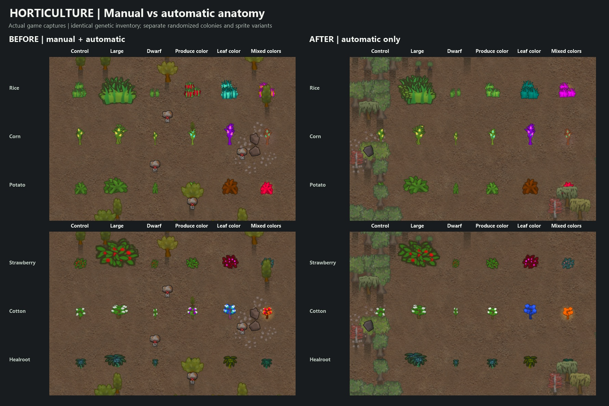

# Automatic-only genetic garden

RimWorld 1.7.5014 rev1195, AllPerformance, run e78140538632464498e62361b98bb004,
source 9a86f19087fb6cbee639cf6ed068944adb11b43a. All seven stages passed.

Before images come from the prior c4a5133f1be143c59469791a0a994020 run
(evidence commit 6adda917b50f20fcd836fad713549ec511506fe9). Identical species and trait
inventories, but distinct random maps and sprite selections; this is not a pixel-matched comparison.
Crops and labels only; plant pixels not edited. Some surrounding vegetation
occludes individual plants. The deliberately extreme colors are a stress test.

New unedited screenshots: [Plot 1](panel-1.png), [Plot 2](panel-2.png),
[Plot 3](panel-3.png), [Plot 4](panel-4.png).
[Per-plant trait and mask-source inventory](garden-inventory.tsv).

All 60 cultivars used locally generated automatic masks. 55 used the GPU
renderer, five oak cultivars used the legacy material path. The 12 vanilla
controls were unstyled. The former manual artwork has been removed from
the staged native package, not from 1.6 or Git history. Automatic generation
reported 87 variations generated, 0 reused/bundled, 0 low-confidence, 0 failed.
That confidence is the classifier's own judgment, not visual validation.
Rice produce pigmentation is less distinct and cotton targeting differs;
further automatic classifier refinement and procedural effects are needed.