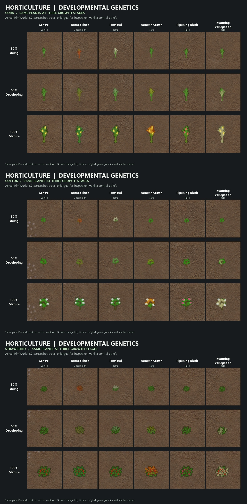

# Horticulture - developmental genetic expression

Actual RimWorld 1.7.5014 rev1195, AllPerformance run 3ecbc2c2a68e4ca0818931f428c11f83,
source ec4008284c5f05373858d18f0c5c1c28f03ca59f.

| Species | Same plants at 30%, 60%, 100% growth |
|---|---|
| Corn | [Comparison](development-corn.jpg) |
| Cotton | [Comparison](development-cotton.jpg) |
| Strawberry | [Comparison](development-strawberry.jpg) |

Untouched captures: [30%](panel-1.png), [60%](panel-2.png), [100%](panel-3.png).
18 unique plants, 15 registered cultivars and three controls, maintained
at identical positions. All 45 cultivar-stage GPU states verified; 30
automatic growth-setter mesh invalidations; 45 cached materials; zero prepared masks.
All six native stages and preservation/cleanup checks passed.

Five cosmetic candidates: Bronze Flush, Frostbud, Autumn Crown, Ripening
Blush, Maturing Variegation. Developmental phase uses three finite bands.
No per-frame material animation or exact organ recognition. Growth was set
by the isolated fixture, not observed over naturally elapsed game time.
The TickLong refresh path, natural growth, save/reload, other species,
performance, combinations and ordinary activation remain unqualified.
No mechanical changes or manual masks. Prior organ-form code retained.

[Genetics inventory](garden-inventory.tsv) | [Verified plant IDs, phases and invalidations](development-inventory.tsv).
