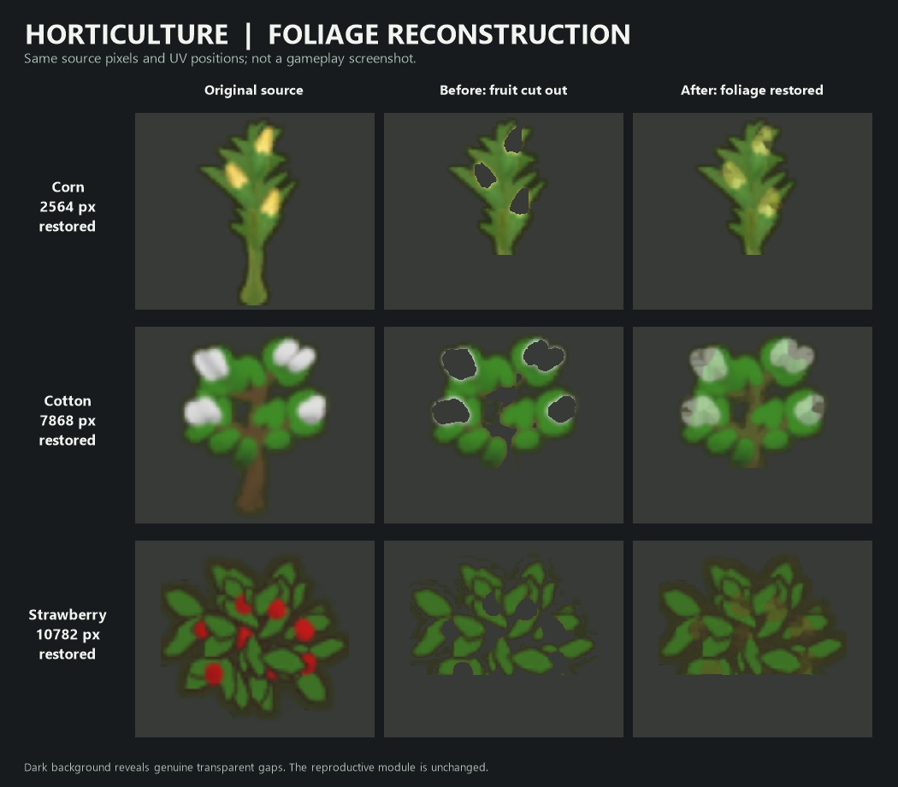
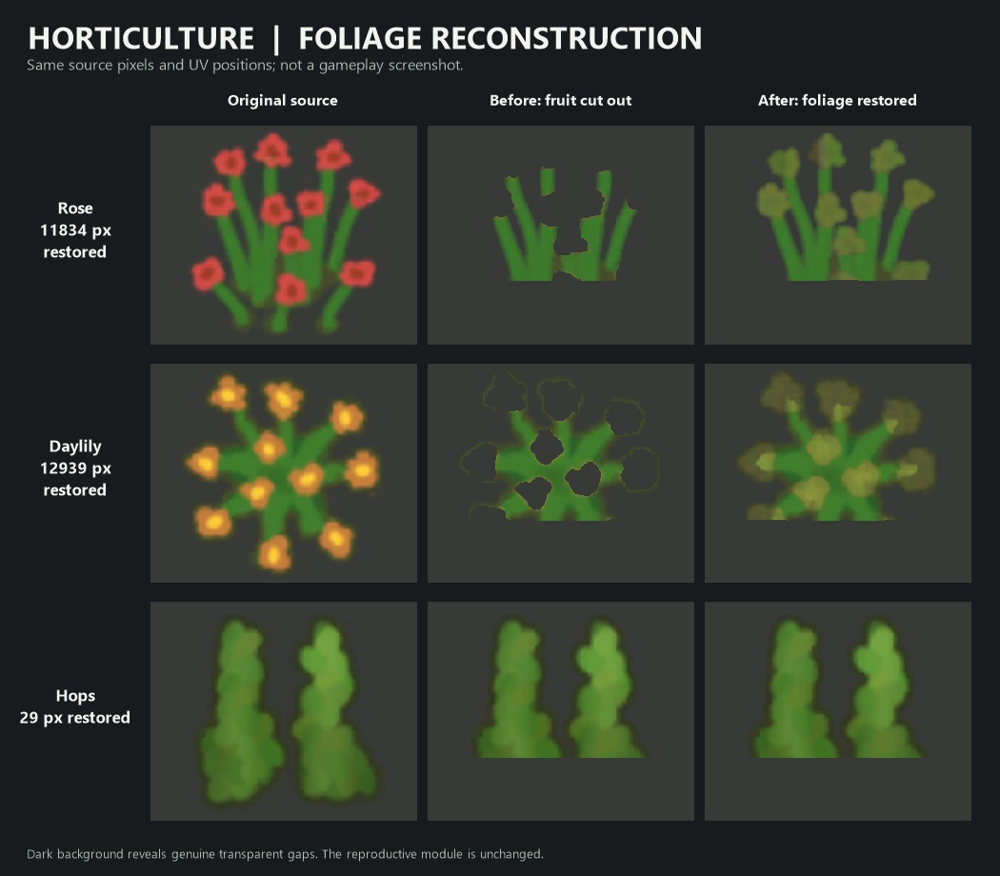
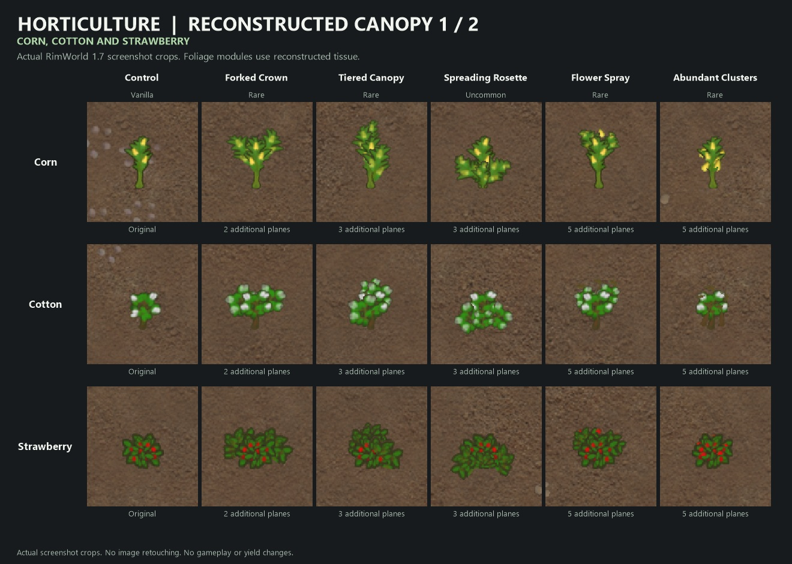
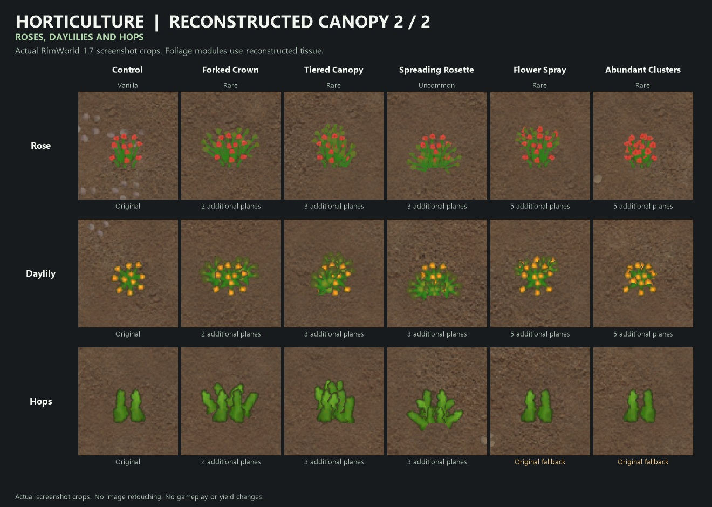

# Horticulture - occlusion-aware foliage reconstruction

Actual RimWorld 1.7.5014 rev1195, AllPerformance run 7376431d40e5429297401ae70d289c26,
source 884ab892a5f473b0c8bd6c6a632cb4924eefbf00.

## Same-source diagnostic

These are source-art diagnostics generated by the game fixture: original, old extraction,
repaired extraction at identical UV positions. Not gameplay screenshots.

## Actual game captures

Untouched game screenshots: [plot 1](panel-1.png) | [plot 2](panel-2.png).

36 plants, 28 rendered variants, two unchanged hops reproductive fallbacks,
98 extra planes, nine prepared module sets, 13 module materials in this run.
Zero custom phenotype shader materials, zero prepared GPU masks.
All five native stages passed, both builds clean, eight new regression checks passed.
The source image is untouched, real alpha gaps preserved, and the reproductive
module is unchanged. Attached opaque source regions use propagated foliage colors.
The two corn textures recovered 2223 and 2564 pixels, respectively. The rose
source still had 899 unreachable reproductive pixels; the algorithm deliberately
does not bridge original transparent space. Pale color/shape echoes of former
fruit remain in some reconstructed modules, notably cotton. Approximate hidden
foliage reconstruction, not ground-truth botanical anatomy. Garden positions
and sprite variants may differ from the earlier garden; the module diagnostic
is the exact same-source comparison. No plant screenshot pixels retouched.

All earlier approved experiments retained, no mechanics or legacy changes.
Wind, combined effects, seasonal graphics, field-scale performance and
ordinary activation remain unqualified. Player preservation/cleanup passed.

[Prepared module counts](architecture-preparation.tsv) | [Renderer inventory](architecture-inventory.tsv) | [Genetics inventory](garden-inventory.tsv).
