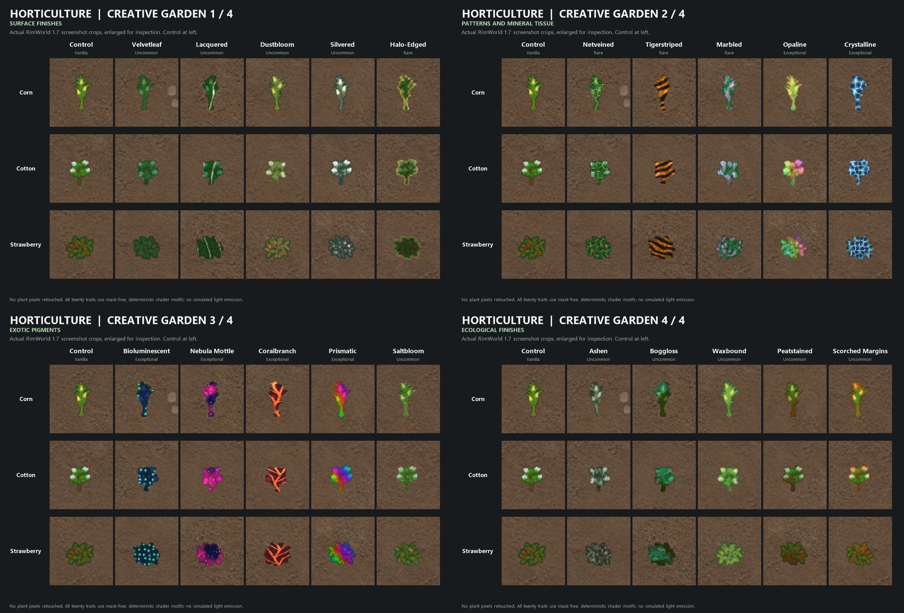

# Horticulture - creative phenotype garden

Actual RimWorld 1.7.5014 rev1195, native AllPerformance run
4ff1cbbf51664e3994dc11de929aad8c, source
1ee47312928b75fbd950ca531a366977dba1a464.

| Labeled close-up sheet | Traits | Untouched game screenshot |
|---|---|---|
| [1](creative-plot-1.jpg) | Velvetleaf, Lacquered, Dustbloom, Silvered, Halo-Edged | [PNG](panel-1.png) |
| [2](creative-plot-2.jpg) | Netveined, Tigerstriped, Marbled, Opaline, Crystalline | [PNG](panel-2.png) |
| [3](creative-plot-3.jpg) | Bioluminescent, Nebula Mottle, Coralbranch, Prismatic, Saltbloom | [PNG](panel-3.png) |
| [4](creative-plot-4.jpg) | Ashen, Boggloss, Waxbound, Peatstained, Scorched Margins | [PNG](panel-4.png) |

Each new phenotype tested on corn, cotton and strawberry with a vanilla
control in each row. 72 actual mature plants, 60 registered single-trait
cultivars, 12 controls, four noon captures, seven stages passed.
60/60 styled plants used mask-free GPU rendering; zero mask textures
prepared. 60 shader materials. The startup classifier still generated
87 automatic masks, none used by these cultivars.
Screenshots cropped and enlarged without retouching plant artwork; raw
full-resolution screenshots retained.

All twenty are zero-default-weight cosmetic prototypes. No existing
trait mechanics or weights changed. Opaline is static simulated iridescence;
Bioluminescent is a color illusion, not actual emitted light; Crystalline
is a surface motif rather than new 3D geometry. No real lighting,
translucency, temporal animation or ecological adaptation mechanics
are added. User review and gameplay audit remain separate.

[Exact per-plant genetic and rendering inventory](garden-inventory.tsv).
All preservation and cleanup checks passed.