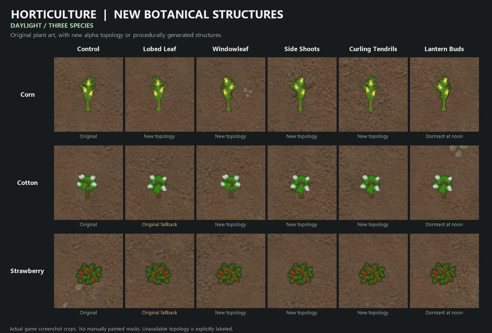
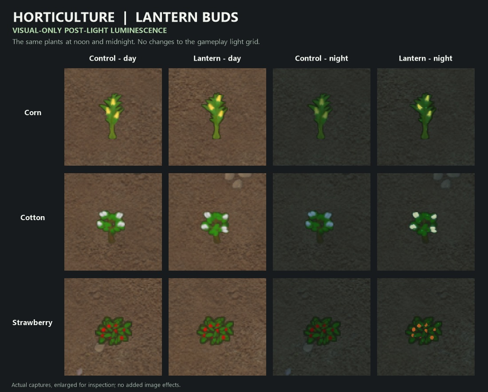

# Horticulture - botanical detail and localized night luminescence

Actual RimWorld 1.7.5014 rev1195, AllPerformance run a93618a6f8b14afba5bd0d99cac1e624,
source 16c9dc8644bf11d9cbbe9c89798f394c4033d13c.

## Daylight leaf topology and new structures

## Nighttime Lantern Buds

Full day-night-day species comparisons: [Corn](detail-corn.jpg), [Cotton](detail-cotton.jpg), [Strawberry](detail-strawberry.jpg).

18 same mature plants: three controls, twelve topology/structure cases and three Lantern Buds cases.
Ten topology cases used modified textures; Lobed Leaf on cotton and strawberry fell back.
Windowleaf, Side Shoots and Curling Tendrils rendered on all three species.
16 prepared textures. Three post-light overlay materials; darkness 0, 1, 0 across the captures.
All six native stages passed. Both builds and 14 added math checks passed.
Normal save/config/preferences preservation and owned test process/package cleanup passed.

The daytime differences are subtle at normal map zoom; the most visually clear new capability is localized
night glow on corn kernels, cotton bolls and strawberry fruit. The cut and addition methods act on
2D source pixels, not exact leaf anatomy. No gameplay light is emitted; the glow is an additive render pass.
All screenshots are actual game crops with labels; no plant pixels retouched. Species comparisons
include the same plants at noon, midnight and daylight again; time changed in the fixture.
No natural cycle, combinations, other growth stages, seasonal assets, editor, performance or release activation qualified.
No manual masks, no balance changes, prior experiments retained.

[Detail renderer states](detail-inventory.tsv) | [Texture preparation inventory](detail-preparation.tsv) | [Genetic inventory](garden-inventory.tsv).

Untouched captures: [daylight](panel-1.png) | [midnight](panel-2.png) | [daylight again](panel-3.png).
