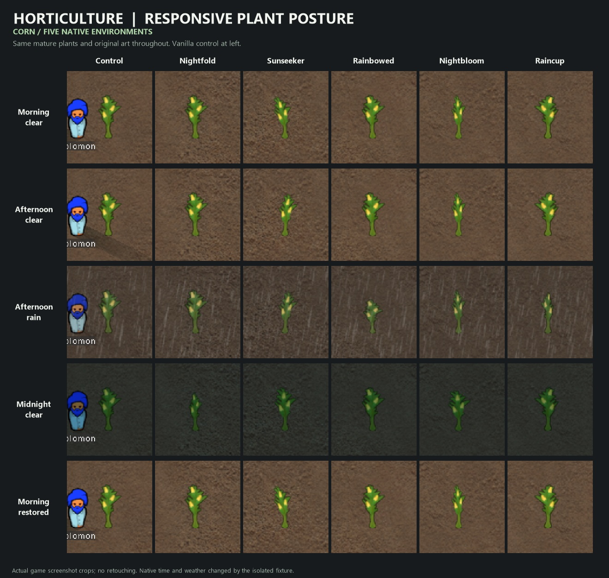

# Horticulture - responsive plant posture

Actual RimWorld 1.7.5014 rev1195, AllPerformance run 6cd683627a914533a897ed11fbad8263,
source 6aade3e74dc7d7d7031548d302ba5b209c8fbacc.

Full gallery: [all species](pose-gallery.jpg) | [cotton](pose-cotton.jpg) | [daylily](pose-daylily.jpg).

18 same mature plants, 15 cultivars and three vanilla controls, fixed positions.
Native time/weather targets: 09:00 clear, 15:00 clear, 15:00 rain, midnight clear,
morning clear again (reported integer hour 8 due to rounding). All 75 material
states verified, same 15 material IDs, 33 changed uniform writes, exact original
quantized morning controls restored. All eight stages passed. Both builds and
seven new math checks (3630 sampled forward/inverse positions) passed.
No extra textures or masks, no pose-time material allocation, no mesh rebuild
requested by this mechanism. Vanilla wind vertex stage retained; wind disabled
for the controlled comparison. Normal player preservation and cleanup passed.

Five zero-weight cosmetic candidates: Nightfold, Sunseeker, Rainbowed, Nightbloom,
Raincup. Shader inverts a bounded analytic UV map; no independent organ articulation.
Sun direction approximates local solar time, not actual ray-traced light.
Visible response on corn, more subtle on compact flowering plants. Rain overlay
and native darkness affect visibility. Some control crops include a pawn label.
Natural tick progression, roof changes, ordinary activation, combined effects,
seasonal sprites, field performance, save/reload and other crops unqualified.
All previous approved experiments, including refined canopy synthesis, retained.

[Exact material states](pose-inventory.tsv) | [Genetics inventory](garden-inventory.tsv).

Untouched captures: [1](panel-1.png) | [2](panel-2.png) | [3](panel-3.png) | [4](panel-4.png) | [5](panel-5.png)
