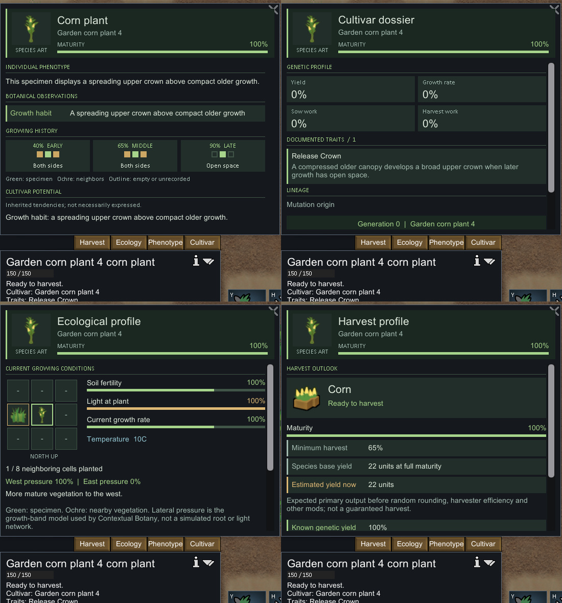

# Botanical Dossier - four native plant inspector tabs

Actual RimWorld 1.7.5014 rev1195 AllPerformance screenshots. Source
[c7f4430](https://github.com/lanwoodall423/Horticulture---Novel-Seeds/commit/c7f4430c0aaae4892e6ba51fb3172b95d5f95225),
run e8f6822bc560487bb2f796310ba802d7.

| Tab | Close-up | Full native screenshot |
|---|---|---|
| Phenotype | [Detail](phenotype-detail.png) | [Full](phenotype-tab.png) |
| Cultivar | [Detail](cultivar-detail.png) | [Full](cultivar-tab.png) |
| Ecology | [Detail](ecology-detail.png) | [Full](ecology-tab.png) |
| Harvest | [Detail](harvest-detail.png) | [Full](harvest-tab.png) |

All four native tabs were opened on the same real selected, documented
Release Crown corn specimen (ID 9159). Actual tab visibility and repaint
were asserted. Phenotype showed three historical observations. Cultivar
showed one authorized trait; this specimen has no parent records.
Ecology used a real newly spawned mature western rice neighbor (one
occupied adjacent cell, west pressure 100%, east pressure 0%), 100%
fertility/light/growth rate and about 10 C temperature. The neighbor was
removed before Harvest. The documented cultivar has a neutral yield
factor, and the read-only primary output expectation was 22 units.

The estimates mirror the inspected native Plant.YieldNow formula before
random rounding and harvester efficiency, with authorized genetic and
synergy factors. The inspector never calls YieldNow or performs harvesting.
A separate fixture checked ordinary species output, pending genetic
factor withholding, mature seed eligibility and immature no-yield/no-seed
eligibility. No seed pack, harvest result or journal observation was
fabricated.

[Native assertions](native-tab-verification.tsv) |
[90 phenotype records](phenotypes.tsv) |
[Player-data preservation](preservation.json).

All eight native garden stages passed, including the previous 75
historical morphology cases and 225 growth observations. Both builds
and existing rule tests passed. Normal saves, preferences and config
unchanged; temporary package and process removed.

The screenshots are genuine unretouched crops of four native tabs, not
mockups. The species/product art is reference art; swatches represent
produce modifiers, not final rendered texture. Scrollable additional
sections exist, but this run captures the initial viewport only. Other
UI scales, nontrivial parent diagrams, non-neutral documented yield
factors, actual seed collection and produce-modifier display are not
individually UI-qualified here. Rarity probabilities are not invented.
No new breeding mechanics, save fields or visual traits were added.