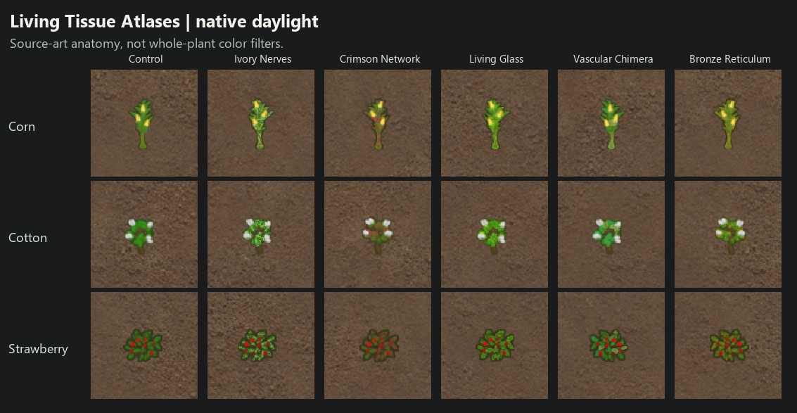

# Living Tissue Atlases - native experimental garden

[Day/night/day comparison](vascular-light-cycle.jpg) |
[Noon original](panel-1.png) | [Midnight original](panel-2.png) |
[Return to noon](panel-3.png).

RimWorld 1.7.5014 rev1195 AllPerformance, source
[c130d80](https://github.com/lanwoodall423/Horticulture---Novel-Seeds/commit/c130d80483e6d4df7292b3e96335419ee4ff692a),
run 352baae65378456ca0b8d11b70eda47f.

Five zero-weight cosmetic alleles: Ivory Nerves, Crimson Network, Living
Glass, Vascular Chimera and Bronze Reticulum. Green foliage is conservatively
classified from the original artwork, rejecting likely reproductive tissue.
Distance-to-boundary and geodesic ownership create local regions, each with
a principal axis and procedural branching marks. R/G/B/A anatomy channels
represent vein strength, thin lamina, territory variation and eligible tissue.
This is an artwork-derived anatomical proxy, not actual individual-leaf
segmentation or physical light transmission. GPU fragment coloring retains
original alpha and includes a live green-color guard. The wind vertex stage
and original texture are retained, with no additional mesh planes.

All six native stages passed. Same 18 corn, cotton and strawberry plants
across noon, midnight and noon: 15 modified specimens, three controls,
45 accepted native material states, zero fallbacks. Five shared 64x64
anatomy maps had 13-21 inferred territories apiece. 15 shared materials
remained stable across all three lighting states, with live sky controls
and descriptions checked. The Living Glass description is absent in
darkness. All existing regression rules and new anatomy rules passed.

[Actual material and phenotype evidence](vascular-inventory.tsv) |
[Source-art map statistics](anatomy-inventory.tsv) |
[Descriptions](phenotypes.tsv) | [Preservation](preservation.json).

Crimson Network and Bronze Reticulum are the most distinct in the
daylight comparison; fine venation is difficult to resolve at ordinary
zoom. Moisture uniform is wired and checked, but wet weather was not
sampled. Per-individual chimera differences, true optical transmission,
ordinary gameplay activation, combinations, larger source art and
dense-field performance are not separately qualified. The fixture is
opt-in and the experimental traits have zero mutation weight.
All captures are unretouched crops of actual game screenshots.
Normal config, preferences and saves unchanged; temporary package removed.

Reproduce with RimWorld closed:

    powershell.exe -NoProfile -ExecutionPolicy Bypass -File DevTools/Run-NativeQuicktest.ps1 -Loadout AllPerformance -VascularGarden