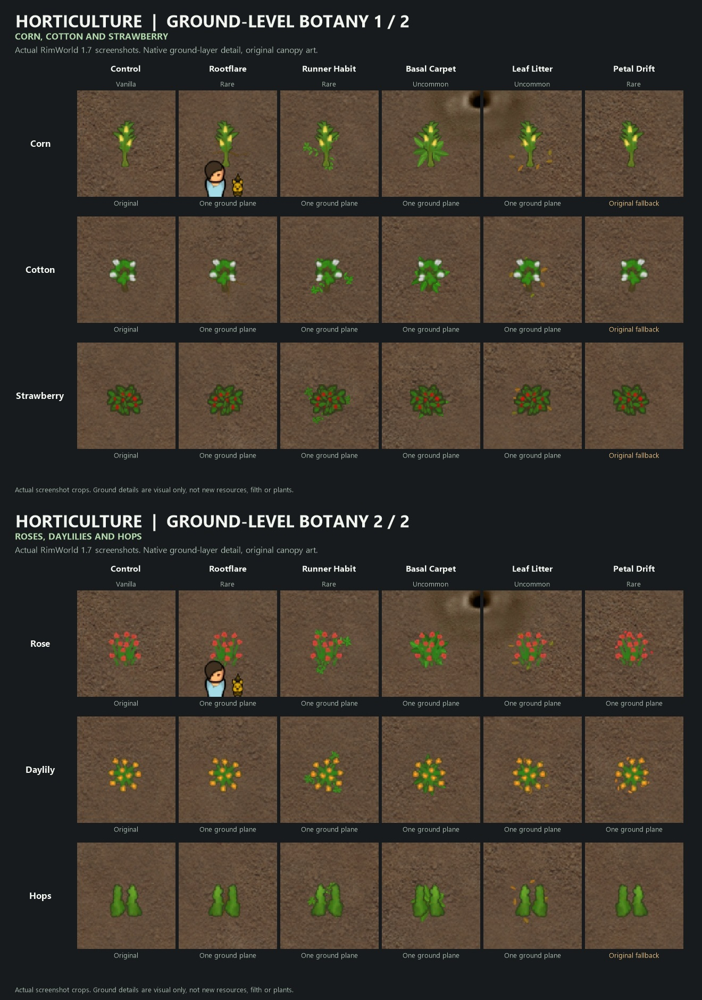

# Horticulture - ground-level botanical structures

Actual RimWorld 1.7.5014 rev1195, AllPerformance run 9e0325490aaf487a8e5d6ada77482eda,
source fe73b09bf6e08bf9e90e7e140216787b4289b773.

| Plot | Labeled close-ups | Untouched screenshot |
|---|---|---|
| Corn, cotton, strawberry | [1](ground-plot-1.jpg) | [PNG](panel-1.png) |
| Rose, daylily, hops | [2](ground-plot-2.jpg) | [PNG](panel-2.png) |

36 mature plants across six species: six vanilla controls, 30 candidate cases.
26 ground planes rendered, four explicit Petal Drift nonflower fallbacks.
39 prewarmed 128x128 textures/materials across nine original source variations;
one plane at Filth altitude per eligible plant, using vanilla Cutout shader.
Zero custom phenotype shader materials and zero GPU masks. All five stages
passed, both builds clean, all prior and 17 new ground math checks passed.
Player saves/preferences/config unchanged and owned process/package cleaned up.

Five neutral zero-default-weight candidates: Rootflare, Runner Habit, Basal
Carpet, Leaf Litter, Petal Drift. Deterministic source-palette-derived shapes;
bounded cache, no drawing or texture creation during Print, no extra spawned
plants, filth, resources or gameplay consequences. Petal Drift only enabled
for the two verified vanilla flowering species. Runners and basal foliage are
most noticeable on upright crops; roots and scatter are subtle against soil
and sometimes obscured by the main canopy. Pawns obscure the corn/rose root
comparison; a small unrelated terrain artifact is visible near the top row.
No plant pixels retouched. Adjacent-cell overlap in dense fields, terrain
and roof transitions, dynamic growth/removal, performance, save/reload,
other species and combination with earlier visual effects unqualified.
All previous experiments including refined canopy and responsive posture retained.

[Renderer and ground altitude inventory](ground-inventory.tsv) | [Palette and preparation](ground-preparation.tsv) | [Genetics inventory](garden-inventory.tsv).
