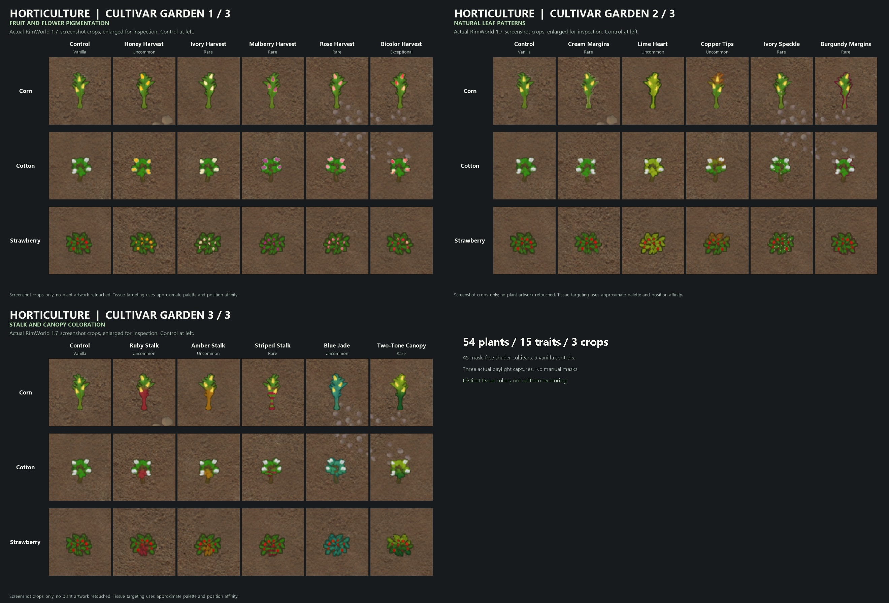

# Horticulture - organ-selective botanical cultivars

Actual RimWorld 1.7.5014 rev1195, AllPerformance run 9edeefb5083a405388cb989c31e8c4ff,
source 591cb28cc4088f8c82ce7ccf476bf4aff1bd4c9d.

| Plot | Labeled close-ups | Unedited screenshot |
|---|---|---|
| Fruit and flower pigmentation | [1](cultivar-plot-1.jpg) | [PNG](panel-1.png) |
| Natural leaf patterns | [2](cultivar-plot-2.jpg) | [PNG](panel-2.png) |
| Stalk and canopy coloration | [3](cultivar-plot-3.jpg) | [PNG](panel-3.png) |

54 mature plants, 45 registered single-trait cultivars and 9 controls.
Each of 15 cosmetic candidates was tested on corn, cotton and strawberry.
All six stages passed; all 45 styled plants printed via mask-free GPU.
48 cached materials, zero prepared mask textures; no relevant HNS error identified.
Three noon screenshots, sky glow 1. All cleanup and player preservation checks passed.

The new effects use soft color affinity for contrasting reproductive tissue,
foliage affinity for leaf patterns, and a lower-central UV proxy for stalks.
Existing automatic regions guide targeting if already active. This is not
exact anatomical segmentation. Warm/pale nonfruit tissues can respond;
compact plants may show central foliage coloration instead of a distinct stalk.
Cream margins and speckle can be subtle at ordinary zoom. No harvested item
color, gameplay mechanics, breeding qualification, or production activation is claimed.
All 15 are zero-default-weight cosmetic candidates pending trait audit.

[Exact per-plant genetic and renderer inventory](garden-inventory.tsv).
