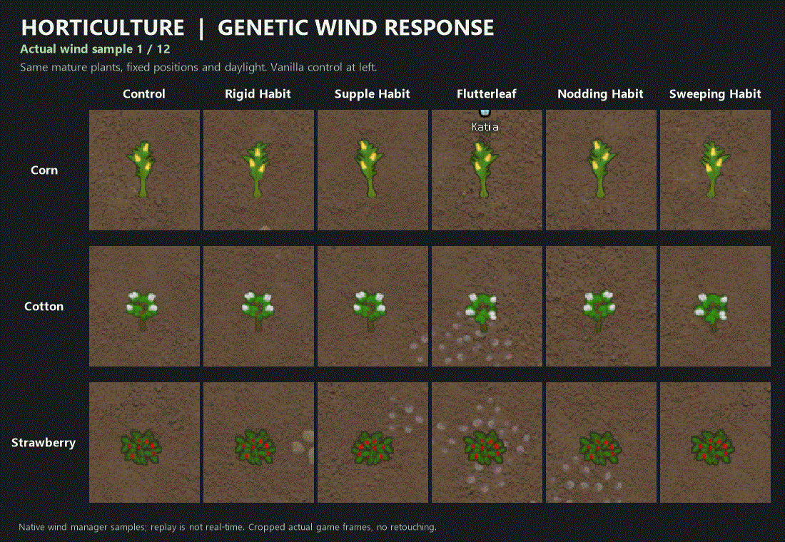

# Horticulture - genetic wind response

Actual RimWorld 1.7.5014 rev1195, AllPerformance run f7d58d8342114a1a8abf3a0e5ea25bfb,
source d4f7362fffd764b3b8181de4a9debb47a301526c.

[Static corn phase comparison](wind-corn-phases.jpg) | [Labeled garden](wind-garden.jpg)

18 same mature plants, 15 cultivars and three original controls, at fixed
positions and local noon. Native WindManager manually advanced while paused;
12 captured phases, 180 verified material-phase states, 15 shared cached
materials, no material count growth across phases, zero prepared masks.
All 15 native stages and preservation/cleanup checks passed.

Five neutral cosmetic wind traits: Rigid Habit, Supple Habit, Flutterleaf,
Nodding Habit and Sweeping Habit. Separate vertex stage uses native wind
phase and exposure, retains anchored bases; no per-plant CPU animation.
No extra texture or mesh subdivision required. This is motion of the
original 2D sprite plane, not physically simulated leaves or branches.
The GIF is a labeled replay of actual frames with 150 ms frame delay;
not real-time footage or a physically seamless cycle. A stationary pawn
label is visible near one corn plant. No plant artwork retouched.

Screen-space green-pixel centroid spans for corn: control X/Y 1.549/1.463 px,
rigid 0.637/0.720, supple 7.214/5.833, nodding 1.868/7.492, sweeping
6.976/2.802. These are image-derived approximate movement measurements,
not tracked vertex displacements or controlled same-position comparisons.
Cotton and strawberry movement is intentionally less visible.

No gameplay balance changes. Prior developmental, organ and form experiments
retained; ordinary activation, natural time progression, combination with
other traits, disabled-wind preference, season/snow and large-field performance
remain unqualified. No manual masks.

[Material-phase evidence](wind-inventory.tsv) | [Screen-space measurements](wind-centroids.csv) | [Genetics inventory](garden-inventory.tsv).

Raw screenshots: [1](panel-1.png) | [2](panel-2.png) | [3](panel-3.png) | [4](panel-4.png) | [5](panel-5.png) | [6](panel-6.png) | [7](panel-7.png) | [8](panel-8.png) | [9](panel-9.png) | [10](panel-10.png) | [11](panel-11.png) | [12](panel-12.png)
