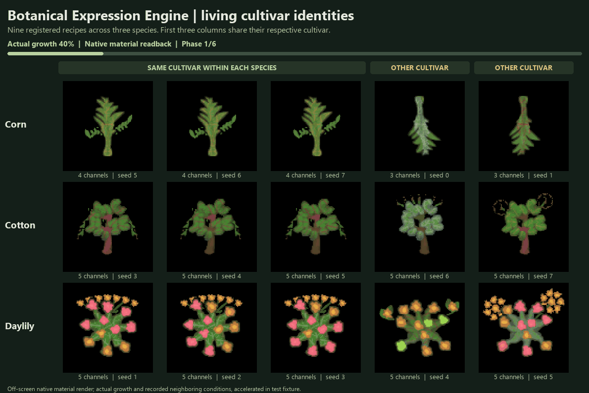

# Botanical Expression Engine: native proof GIFs

[Same cultivar, different developmental histories](individual-histories.gif) |
[Corn](corn-identities.gif) | [Cotton](cotton-identities.gif) |
[Daylily](daylily-identities.gif)

Source [340fc36](https://github.com/lanwoodall423/Horticulture---Novel-Seeds/commit/340fc36dce547637a5683dd9665918e3b87aa249).
RimWorld 1.7.5014 rev1195, isolated AllPerformance run
0e4b5e7b427a4a8591a468f97379cd12.

The same 18 actual live plants (15 modified, three original controls)
were grown through 40%, 55%, 65%, 80%, 90%, 100% by the actual Plant.Growth
setter. Nine registered cultivar identities, five inherited traits per
cultivar. Within each species, the first three individuals have one
registered cultivar identity; the next two have different recipes.
Different real lateral rice neighbors were present at the three growth
history thresholds. Final first-three specimens had no lateral neighbors.
Recorded history codes 146, 219 and 209 give opposite and mixed bias.
Thing ID-derived individual seeds remain stable. 90 live shader and native
mesh payload checks and 90 native GPU material readbacks passed;
all fifteen mature specimens accepted all five channels. Original art
controls are matched to each accepted material. The GIFs are off-screen
material previews at equal source pixel scale, six real rendered growth
states played forward/backward, not full-map gameplay recordings.
Wind is frozen only in preview copies. Actual changes in growth and
neighbors were applied to the isolated game, not advanced naturally over days.

**Fixture outcome: partial.** The six render phases were captured
successfully, but the final native laboratory GUI repaint assertion
failed, so the entire run receipt is FAIL. Final aggregate assertions
were not reached in this run. No claim of successful laboratory UI test
or production qualification is made. The exact failure is in the receipt.
The shader/render evidence is independently retained. Normal player
configuration, preferences and saves were unchanged; temporary package
and process removed.

[Native render evidence](native-expression.tsv) |
[Phenotype observations](phenotypes.tsv) |
[GIF manifest](gif-manifest.json) |
[Raw GPU images](frames/) |
[Native test receipt](receipt.json) |
[Player data preservation](preservation.json).

This is an opt-in renderer with an explicit 18-trait promotion list,
not activation of the entire library. Species family assignment is
conservative and currently explicit; unknown species have limited
eligible architecture. The four tier labels do not change mutation
weights. Some experimental traits still share legacy exclusion tags;
natural multi-trait discovery and breeding compatibility are not
qualified. Dense-field performance, save/reload, map appearance and
arbitrary genetic combinations remain unqualified. No new gameplay
mechanics or save fields.

## Follow-up verification

Source 712f4c8738620175e437bd9f22cd0ca90e311570, isolated run 7651faa60355450f9857d6c95e2d2517, status FAIL.
[Receipt](verification/receipt.json) and [preservation](verification/preservation.json).
The first run's GIFs above are retained unchanged.

Follow-up did not complete: System.InvalidOperationException: actual neighboring test cell  [Ref E9FFCBE4]    at HorticultureNovelSeeds.NativeGardenProbe.Require(Boolean value, String label) in HorticultureNovelSeeds.dll:token 0x600040e+0x9     at HorticultureNovelSeeds.NativeGardenProbe.AdvanceExpressionGrowth() in HorticultureNovelSeeds.dll:token 0x60003f8+0x13d     at HorticultureNovelSeeds.NativeGardenProbe.MakePanel() in HorticultureNovelSeeds.dll:token 0x60003de+0x4e5     at HorticultureNovelSeeds.NativeGardenProbe.Begin(String path, Action`1 stage, Action`2 completed, Boolean procedural, Boolean catalog, Boolean creative, Boolean cultivar, Boolean form, Boolean organ, Boolean development, Boolean wind, Boolean surface, Boolean detail, Boolean architecture, Boolean pose, Boolean ground, Boolean articulation, Boolean mosaic, Boolean neighborhood, Boolean chronicle, Boolean vascular, Boolean lifeSuite) in HorticultureNovelSeeds.dll:token 0x60003d6+0xe70
