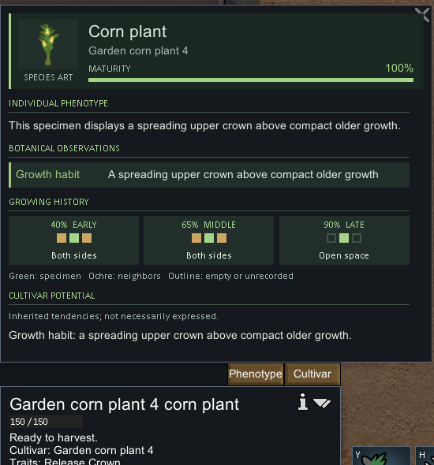

# Native Phenotype inspector tab

[Unretouched full game screenshot](phenotype-tab.png) |
[Exact selected specimen notes](phenotype-tab.txt) |
[All 90 phenotype records](phenotypes.tsv) |
[75 native growth history records](chronicles.tsv) |
[Preservation check](preservation.json)

RimWorld 1.7.5014 rev1195, AllPerformance, source commit
18dc0591425354e9ee9d314c83d0fb987d8db0f9. Run
d6211ef28f71400fa45cc17a12fb0bc4.

The separate Field notes window/command and lengthy inspect-string
description have been replaced by a native Phenotype tab next to Cultivar.
The illustrated header is labeled species art, not a specimen render.
The tab uses native typography, colored botanical regions, maturity,
recorded growth history, and documented cultivar potential. The tab is
visible for individual selected plants with traits. Undocumented
cultivars do not expose inherited tendencies.

The fixture selected an actual corn specimen and opened the native
inspector's Phenotype tab. It asserted the tab was visible and actually
repainted, with facts, all three historical samples and authorized
potential matching the selected specimen. All eight stages passed:
90 plants including 15 controls, 75 historical cases, 225 growth samples.
Both builds and vocabulary regression tests passed. Normal configuration,
preferences and saves were unchanged; the temporary test was removed.

The screenshot detail is an unretouched crop. The tab's history diagrams
reflect the existing three lateral competition observations only, not
unimplemented frost, damage, wind or seasonal histories. Other renderer
families use the same tab but have not been individually requalified
with the new UI. UI scale extremes and non-English body text are not
qualified.