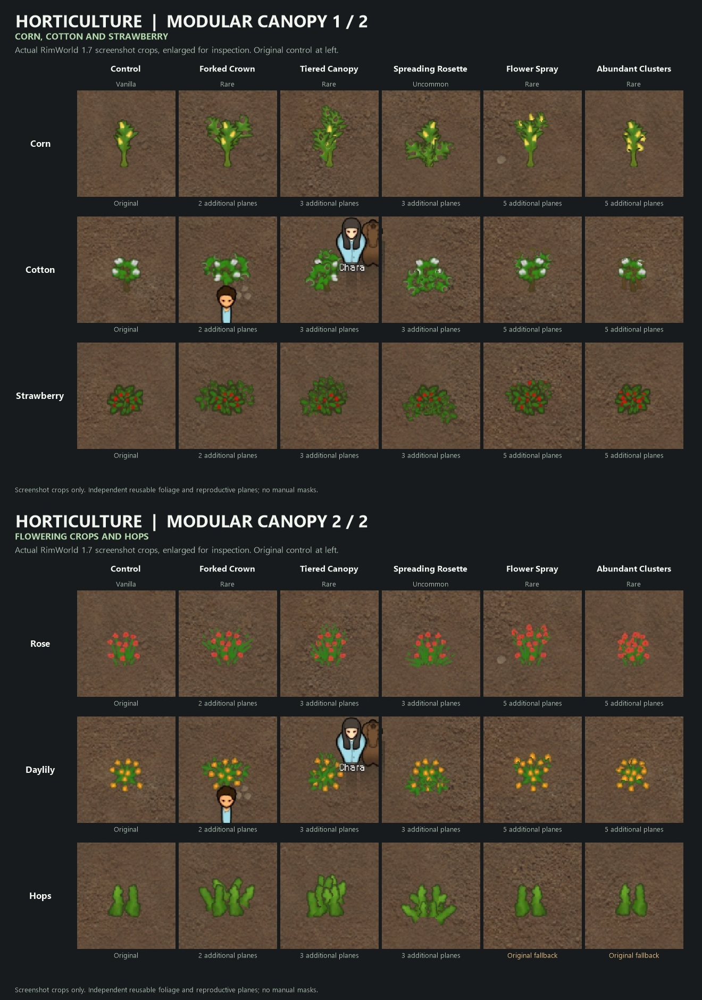

# Horticulture - modular canopy architecture

Actual RimWorld 1.7.5014 rev1195, AllPerformance run 780719be31724cd7b262a63802f57162,
source 89ebcec011d1ace2a55592ab7c25655a9e41e7e8.

| Plot | Labeled close-ups | Untouched screenshot |
|---|---|---|
| Corn, cotton, strawberry | [1](architecture-plot-1.jpg) | [PNG](panel-1.png) |
| Rose, daylily, hops | [2](architecture-plot-2.jpg) | [PNG](panel-2.png) |

36 mature plants, six vanilla controls, 30 neutral experimental cultivar cases.
28 rendered: 98 additional planes, 9 prepared source-art module sets and
15 module materials. Both hops reproductive arrangements fell back; no
reliable fruit module was available. All five native stages passed.
Zero custom phenotype shader materials and zero prepared GPU masks.
Both builds clean; all prior rule tests and nine architecture tests passed.
Normal saves, preferences and config unchanged; owned process/package cleaned up.

First run 929b6c411b844c6a8cdfb9a021babaf5 captured 28 rendered cases
but failed the no-custom-shader assertion (three unintended pigment materials).
Fixed in 89ebcec by isolating the original base material path, then reran.
The evidence here is exclusively from the successful corrected run.

Forked crowns, tiered canopies and spreading rosettes noticeably change
plant silhouettes, especially corn and hops. Extra flower/fruit arrangements
are more subtle on some species. Some pawn labels obscure parts of the cotton
and daylily comparisons. Source-art modules are approximate, not exact
anatomy; overlapping structures can look too dense or disconnected.
The screenshots are crops and labels only, no plant artwork retouched.

Wind disabled in this isolated fixture; attachment under wind, compatibility
with other visual traits, growth transitions, large-field performance, seasonal
assets, editor, save/reload, natural breeding and ordinary activation unqualified.
No mechanical yield or balance changes. All five candidates zero default weight.
Prior visual experiments retained, including approved Lantern Buds.

[Plant inventory](garden-inventory.tsv) | [Additional plane counts](architecture-inventory.tsv) | [Source module preparation](architecture-preparation.tsv).
