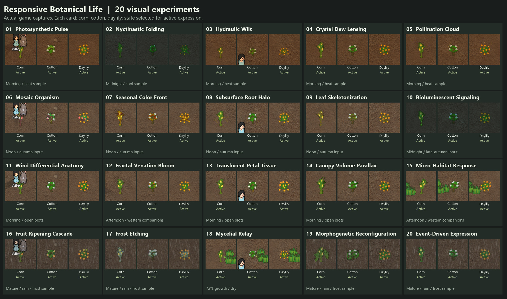

# Responsive Botanical Life - twenty native visual experiments

RimWorld 1.7.5014 rev1195, AllPerformance loadout, source
[485698e](https://github.com/lanwoodall423/Horticulture---Novel-Seeds/commit/485698e5d9f9ced867b9b71731c0baaa694d2d72),
isolated run 2f913ca27ff74a23a0243bf778345541.

| Experimental group | Comparison sheet | Original game screenshots |
|---|---|---|
| 1-5: Tissue and weather | [Day/night](life-suite-group-1.jpg) | [Morning/heat input](panel-1.png), [Midnight/cool](panel-2.png) |
| 6-10: Seasonal and ground expression | [Day/night](life-suite-group-2.jpg) | [Noon/autumn input](panel-3.png), [Midnight/late autumn input](panel-4.png) |
| 11-15: Anatomical motion and habitat | [Open/neighbor](life-suite-group-3.jpg) | [Morning/open](panel-5.png), [Afternoon/companions](panel-6.png) |
| 16-20: Growth and connected ecology | [Developing/mature](life-suite-group-4.jpg) | [72% growth/dry](panel-7.png), [Mature/rain/frost input](panel-8.png) |

All eleven native stages passed. Four separate gardens each contain 18
subjects (corn, cotton, daylily; one vanilla control and five real
registered experimental cultivars per species). The same subjects in
each garden were captured twice: 72 distinct subjects, 60 modified,
12 controls, 120 accepted native modified rendering states, 93 active
states and 27 dormant states, zero fallbacks. All twenty modes active
on all three species at least once. The three atlas modes each passed
all six states. All preparations preserve original atlas alpha.
Eight shared source anatomy maps; material and extra-plane counts are
bounded. Five modes use one extra plane per source sprite.
Actual source-organ maps, appearance vocabulary, and shader parameters
were checked. No image was generated or retouched; gallery cells are
labeled crops. Incidental colonists/animals appear in several crops.

[Native rendering evidence](life-suite-inventory.tsv) |
[Prepared anatomy and atlas evidence](anatomy-preparation.tsv) |
[Phenotype text](phenotypes.tsv) |
[Player data preservation](preservation.json).

The experiments are opt-in with zero mutation weights. The suite includes
native time, sky and rain signals, actual plant growth, and actual
lateral neighboring plants. Temperature and seasonal inputs in this
fixture are controlled overrides, not claims of naturally simulated
heat/frost or seasonal passage. The relay is decorative and connects
actual same-allele neighboring plants; no nutrient transfer. Pollination
is decorative; maturity and inferred reproductive artwork gate a sparse
particle-like overlay, not a pollination mechanic. Dew and tissue
transmission are optical illusions, not physical refraction. Parallax
uses a separate foliage layer and clip-space displacement, not a true
3D plant; camera movement has not been separately measured. The new
event-driven prototype covers rain only. The wilt prototype uses heat
and injury as visual proxies; no hydraulic or drought model. Atlas
movement is bounded and frame-based; screenshot captures do not qualify
continuous animation or every visual combination.

The screenshot review finds the clearest effects in Hydraulic Wilt,
Mosaic Organism, Seasonal Color Front, Bioluminescent Signaling,
Micro-Habitat Response, Frost Etching and Morphogenetic Reconfiguration.
Pollen, dew, vein detail, depth and fine soil threads are subtler at
normal zoom. Ordinary gameplay activation, runtime refresh of local
stress and neighbor/growth inputs without a forced mesh refresh,
save/reload, dense fields, non-tested species and combinations remain
unqualified. The previous rendering paths are preserved in separate
experimental modes. Normal saves/preferences/config unchanged.

Reproduce with RimWorld closed:

    powershell.exe -NoProfile -ExecutionPolicy Bypass -File DevTools/Run-NativeQuicktest.ps1 -Loadout AllPerformance -LifeSuiteGarden -TimeoutSeconds 230