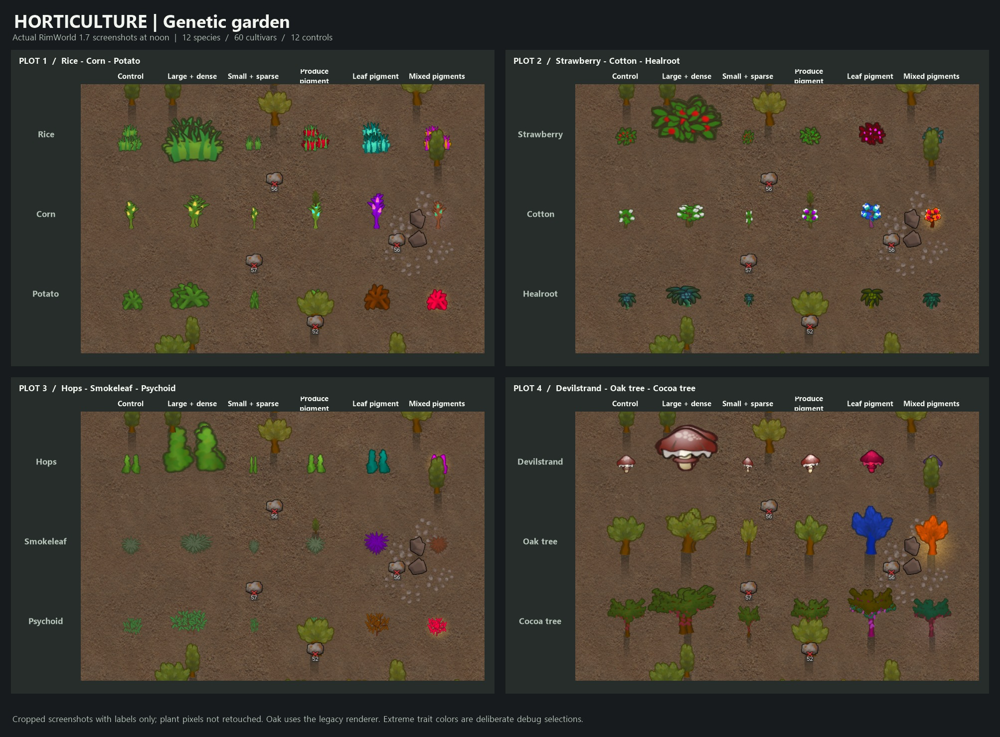

# Horticulture genetic garden - visual inspection

Actual RimWorld 1.7.5014 rev1195 screenshots from isolated AllPerformance run
c4a5133f1be143c59469791a0a994020, source commit
360a33c058ba734c1597319a0ec4d6e9b42b9bf1.

Raw full-resolution screenshots: [Plot 1](panel-1.png) | [Plot 2](panel-2.png) |
[Plot 3](panel-3.png) | [Plot 4](panel-4.png).

Every plot has three rows of plant species, six columns: unmodified,
large/dense/robust, dwarf/sparse/delicate, produce pigment + disease resistance,
leaf pigment + giant + cold resistance, and combined produce/leaf/stem colors +
beauty or ugliness plus a resilience trait. All cultivars are real registry
records using existing trait definitions and generated color traits. Colors
and combinations were deliberately selected beyond normal mutation/palette
rules; these are not claims about natural occurrence.

12 control plants, 55 GPU-masked cultivars, 5 oak cultivars on the legacy
material path. The game was paused at local noon with clear weather. The
gallery only crops and labels screenshots; individual raw PNGs are untouched.
[Exact per-plant genetics and backend inventory](garden-inventory.tsv).

The native test passed all seven stages; its temporary game and installation
were cleaned up, and normal configuration/preferences hashes and save
inventory were unchanged. No production release or shader default was changed.