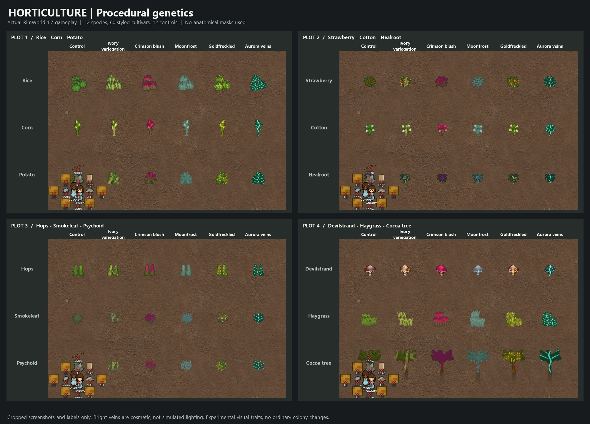

# Horticulture procedural genetics - visual review

Actual RimWorld 1.7.5014 rev1195 screenshots from isolated AllPerformance
run ad56abd8b279415ca45b8b10b149e411, source
662da1294fe5f440b6c2ed14ff316336a210622f.

Raw unedited captures: [Plot 1](panel-1.png) | [Plot 2](panel-2.png) |
[Plot 3](panel-3.png) | [Plot 4](panel-4.png).

Every row has a control followed by Ivory Variegation, Crimson Blush,
Moonfrost, Goldfreckled and Aurora Veins. These are actual registered
genetic trait definitions. All 60 styled plants exercised the mask-free
GPU path; 12 controls used vanilla. No anatomical masks were prepared
for the garden renderer. The startup automatic classifier still ran.
No per-plant styled textures or hand-painted regions were used for the
five procedural styles. Shader color effects are static and cosmetic.
Aurora Veins does not emit real light. All seven garden stages passed;
no Horticulture-specific error identified in the captured log.
The first iteration passed its visual stages but raised cosmetic catalog
validation errors; the final run corrects that issue and improves frost
shading and plot clearance. Daylight local hour 12; sky glow 0.962347.
A few colonists/items partly obscure the bottom-left crop in plot 2.
No plant pixels retouched; gallery crops and labels only.
[Exact plant inventory](garden-inventory.tsv).

The test process and temporary installation were removed and normal
configuration, preferences and save inventory were verified unchanged.
The traits remain zero-default-weight and the shader experimental;
ordinary activation, natural mutation/breeding and save migration
for the new alleles are not qualified by this garden.