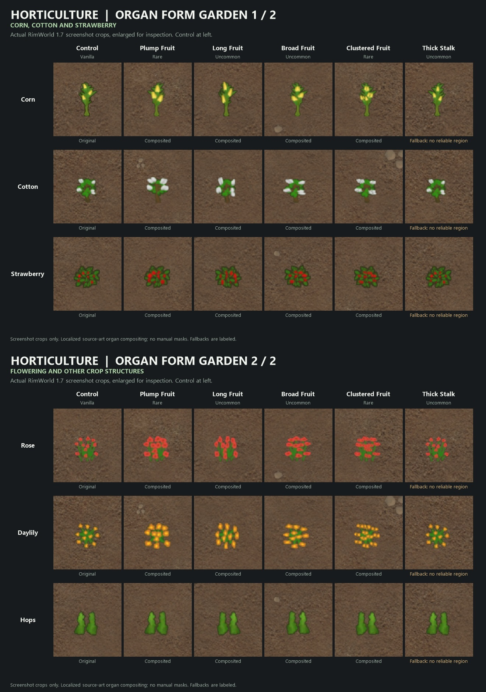

# Horticulture - experimental organ-form cultivars

Actual RimWorld 1.7.5014 rev1195, AllPerformance run da6439b696e2455bb4e4bd4386eb8d89,
source e2a43148e6ff5449e0ce3d01710b32dd5f10c5f3.

| Plot | Labeled close-ups | Untouched screenshot |
|---|---|---|
| Corn, cotton, strawberry | [1](organ-plot-1.jpg) | [PNG](panel-1.png) |
| Rose, daylily, hops | [2](organ-plot-2.jpg) | [PNG](panel-2.png) |

36 plants, six controls, 30 experimental cultivar cases.
All 24 reproductive-form cases (Plump, Long, Broad, Clustered Fruit) used
the organ composite with the original plant shader. All six Thick Stalk
cases explicitly fell back: no credible stem component was prepared.
Five native stages passed; 36 prepared textures, zero custom shader materials
or prepared GPU masks. Two daylight screenshots. Player preservation and
test cleanup checks all passed. No relevant Horticulture error identified.

This is source-art sprite compositing, not independent 3D organs: palette
and existing automatic classification identify candidate connected regions,
then local resampling/overlays preserve the untouched original elsewhere.
Overlays can obscure nearby foliage, and adjacent organs can merge.
No exact anatomical recognition is claimed. Hops variants are barely
visible; long/broad flowers can look excessively stretched. The most
promising are plump strawberries, fuller cotton bolls and flower clusters.
The screenshots are crops and labels only, no plant pixels retouched.

No manual masks, no new artwork, no per-frame readback. Preparation and
material caches are bounded, but memory, batching and startup impact have
not been benchmarked. Pigment combinations, growth stages, snow, editor,
natural inheritance and save/reload not qualified. No ordinary activation
or balance changes. All five candidates have zero default mutation weight.

[Exact per-plant inventory](garden-inventory.tsv) | [Component preparation inventory](organ-preparation.tsv).
