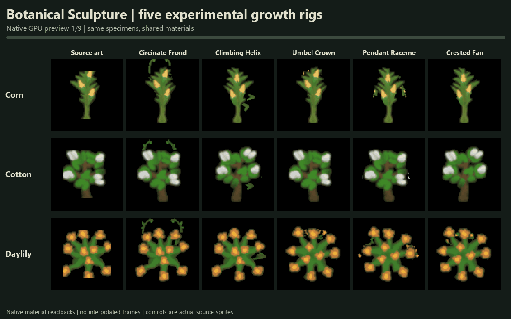

# Botanical Sculpture: five native developmental previews

## Individual GIFs

- [Circinate Frond](01-circinate-frond.gif)
- [Climbing Helix](02-climbing-helix.gif)
- [Umbel Crown](03-umbel-crown.gif)
- [Pendant Raceme](04-pendant-raceme.gif)
- [Crested Fan](05-crested-fan.gif)

These are native RimWorld 1.7 GPU material readbacks, NOT full-map
screenshots. The full-window screenshot writer timed out on the first
attempt (run 2337343640c446598abd406c920cd010). The replacement fixture
ran the actual shader on off-screen targets using each live specimen's
accepted material, with wind frozen in a preview-only copy. Nine
controlled developmental phases are played forward then backward for
a 16-frame loop. No fabricated or interpolated frames. Source art
and cultivar images are at identical native pixel scale.

## Verification

Native run e3c7d60e2b694baaaff9ce482d4fdb0a, source
[4ec61e5](https://github.com/lanwoodall423/Horticulture---Novel-Seeds/commit/4ec61e5b643b3c867bf81bb72953d888e67d8743),
AllPerformance loadout, RimWorld 1.7.5014 rev1195.

All 12 fixture stages passed. 18 distinct plants, including 15 modified
specimens; 135 accepted native material/phase samples, 135 GPU captures,
nine distinct frame hashes for each specimen, 15 matched original-art
GPU controls. Maximum direct interior-source RGB error 0.00008807305
on a normalized 0-1 scale; orientation comparison passed. No additional
mesh planes. Both builds and regression rules passed. Normal save data,
configuration, and preferences preserved; isolated test package removed.

[Native materials](native-materials.tsv) |
[GPU frame hashes and orientation checks](native-gpu-frames.tsv) |
[Atlas preparation](atlas-preparation.tsv) |
[Phenotype descriptions](phenotypes.tsv) |
[Raw GPU images](frames/) |
[Preservation](preservation.json).

Five cosmetic zero-mutation-weight experimental traits use source-colored
curves and foliage blades with selected source-art reproductive stamps.
The original occupied sprite pixels are retained exactly in CPU atlas
preparation. A padded 1.5x canvas and correspondingly enlarged native
plane accommodate the added growth. The GIFs use sampled phase uniforms,
not natural growth or ordinary gameplay activation. Some extended tips
can reach the bounded canvas, and the repeating organ stamps and branch
geometry can look more stylized than native art. Map-scale appearance,
camera/wind behavior, ordinary activation, combinations and dense fields
remain unqualified.