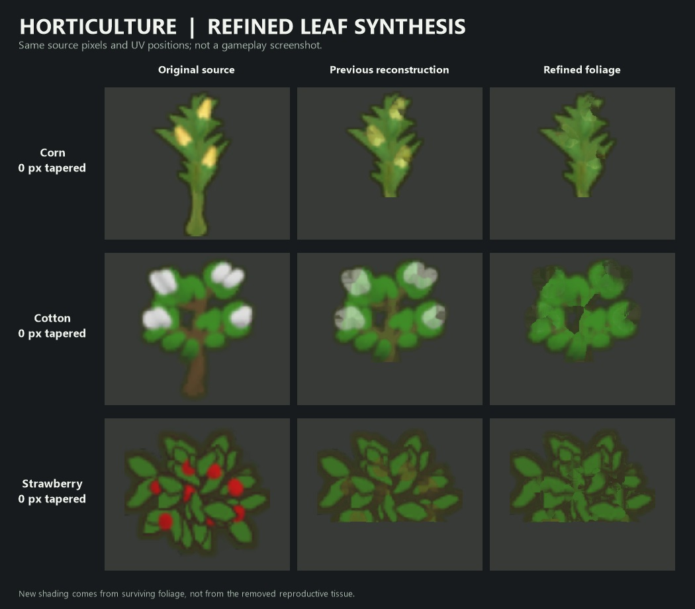
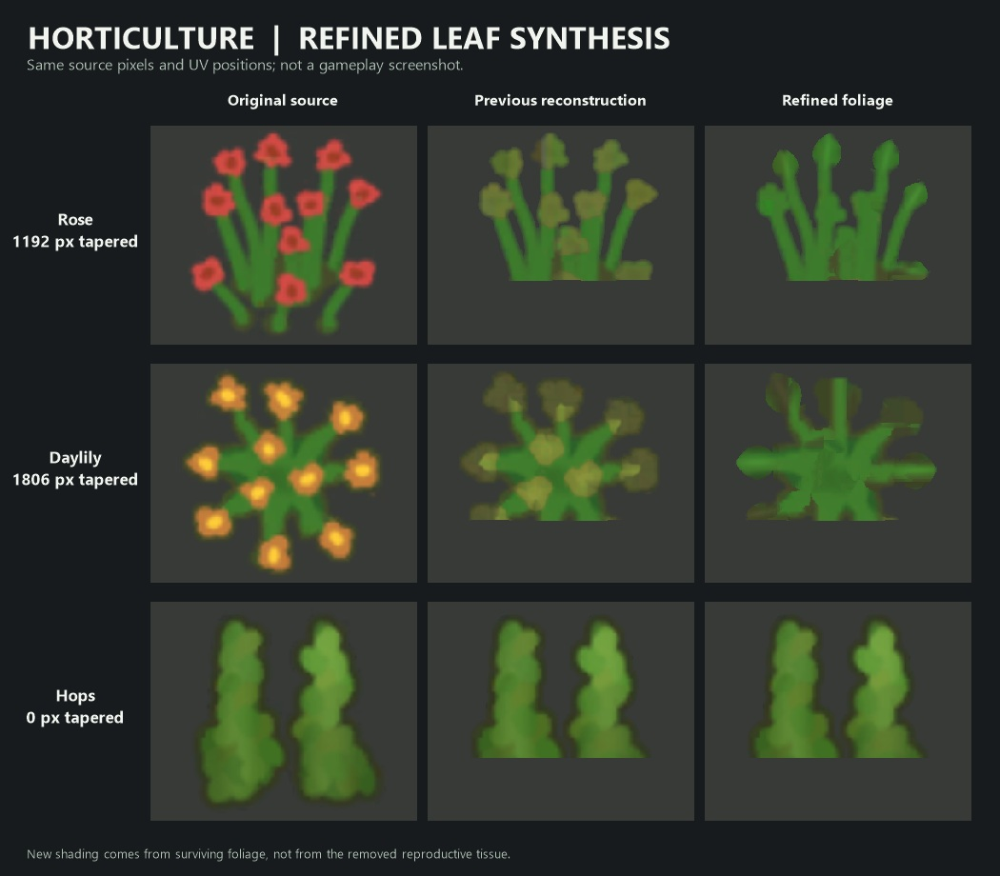
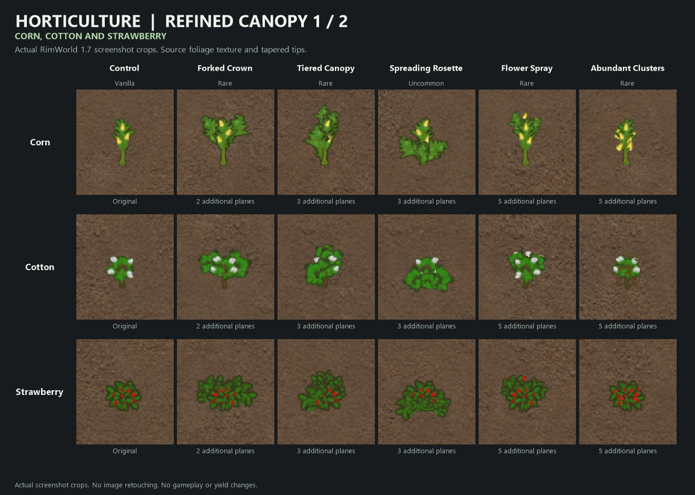
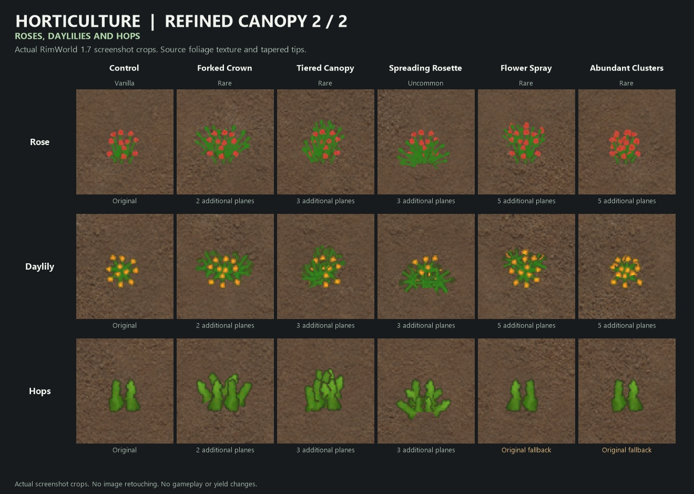

# Horticulture - refined leaf synthesis

Actual RimWorld 1.7.5014 rev1195, AllPerformance run 6b89f61d1c794cc6a52bd943666eab99,
source 1b94adc7e564113ecf1d5c0270cc288db5007eef.

## Same-source comparison

These strips are produced from the same source pixels by the fixture: original,
previous occlusion repair, new synthesis. They are not gameplay screenshots.

## Actual game captures

Untouched screenshots: [plot 1](panel-1.png) | [plot 2](panel-2.png).

36 mature plants, 28 rendered variants, two original hops reproductive fallbacks,
98 additional planes, nine source module sets, 16 module materials.
Zero custom phenotype shader materials and zero prepared GPU masks.
All five stages passed; both builds clean, all prior and four new regression checks passed.
Normal saves/config/preferences unchanged; owned process/package cleaned up.

New reconstruction excludes reproductive-color fringe from foliage donors,
transfers nearby real leaf shading independent of original fruit brightness,
and selectively tapers exterior-connected protrusions. All alpha is bounded
by original source alpha; real enclosed gaps and reproductive extraction preserved.
Tapering affected rose (1192 pixels) and daylily (1139/1806 pixels); corn,
cotton and strawberry improved primarily through color/texture synthesis.
Cotton remains rounded and some reconstructed foliage is flatter than the original.
Rose has 899 unreachable reproductive pixels; hops fruit modules remain unavailable.
Approximate source-derived anatomy, not ground truth. Some underlying cropped
module base edges are visible on isolated diagnostic sprites. Wind, combined
traits, natural growth, field performance and ordinary activation remain unqualified.
No manual masks, balance changes or changes to previous approved visual systems.

[Preparation and taper counts](architecture-preparation.tsv) | [Renderer inventory](architecture-inventory.tsv) | [Genetics inventory](garden-inventory.tsv).
