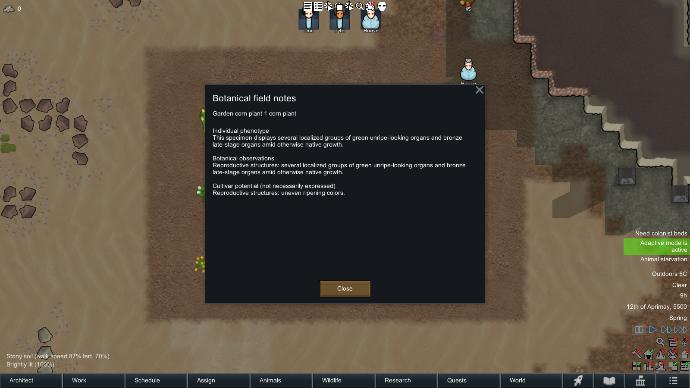

# Botanical field notes - native evidence

Two isolated native RimWorld 1.7.5014 AllPerformance fixture runs:
- Form Garden: ad0673df78e0483bbe98346ac1fadb82, source 194aab84c56750b1ef6fb11ea079816471a36ce8. 36 plants, 15 form-only, 15 combined form and pigment, six controls. Actual emitted geometry/material facts drive both inspect prose and the documented-cultivar potential.
- Mosaic Garden: 47b7d834100145f0948c9398a2d897df, source 54676c8ebb45c92ac0d67a82aec71183ef523376. 90 plants, 75 expressed mosaic specimens, 15 controls. Actual changed organ-state metadata from the atlas variant selected by each plant's stable mesh seed drives its description.

[Field notes window (actual game capture)](field-notes.png) |
[Exact text](field-notes.txt)

[Form descriptions](form-phenotypes.tsv) |
[Mosaic descriptions](mosaic-phenotypes.tsv)

[Pure morphology garden](form-only.png) |
[Combined morphology/pigment garden](form-and-pigment.png) |
[Individual mosaic garden](mosaic-garden.png)

The TSV records are exported by the live native fixture and contain plant ID,
observed facts, combined inspection prose, categorized botanical observations,
recorded history, and authorized cultivar potential. Controls do not acquire
invented descriptions. The field notes screenshot is captured after invoking
the real plant Field notes command.

[Form preservation](form-preservation.json) |
[Mosaic preservation](mosaic-preservation.json)

The vocabulary and observation system adds no persistent state, genetic
mechanics, per-individual material, or new animation. It records successful
render paths and reads active shared uniforms at inspection. It is not image
recognition or a claim of anatomically exact segmentation. Other renderer
families have vocabulary and observation hooks but have not all been re-run
with the description assertions. Growth history uses existing Chronicles
data only; the earlier frost/recovery/wind/seasonal extensions are separate
unfinished experiments.