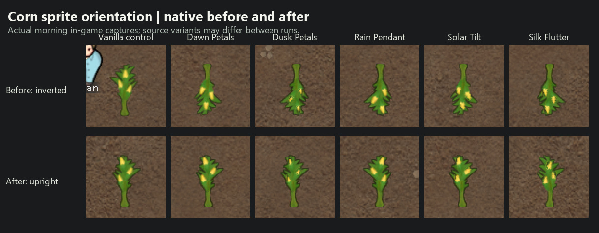

# Horticulture - upright organ articulation (orientation correction)

Native RimWorld 1.7.5014 rev1195, AllPerformance run
69d66e7ca1b94458b9c4dd4623a04bd7, source
[1c4ce8c7fe81431126f7bc61beb7243bee37fea7](https://github.com/lanwoodall423/Horticulture---Novel-Seeds/commit/1c4ce8c7fe81431126f7bc61beb7243bee37fea7).

The previous gallery selected the correct atlas cell, but the sprite
inside each cell was vertically inverted. The fixture's unordered swatch
comparison did not test orientation. Local UV.y inversion is independent
of atlas row selection and preserves the nine-frame mapping. The new test
renders each real vanilla source and its exact neutral atlas pose to the
same dimensions using native GPU readback, compares corresponding pixels,
and checks vertical/horizontal/combined reflections. All 30 passed:
five traits across six source variations (corn, cotton, daylily).
Maximum direct normalized RGB error: 3.9550345E-05.
Minimum vertically mirrored error: 0.28800803.

All nine frame indices, all eight native stages and 75 material states
passed; 15 cultivars, three controls, 30 atlases and five native conditions.
All preservation/cleanup checks passed. All previous rule tests passed;
fixture build had no warnings/errors. The new corn close-up was visually
inspected and all five traits are upright in all five captures.
No pixels in the source captures have been retouched or flipped in editing.

[All species overview](articulation-gallery.jpg) |
[Corn](articulation-corn.jpg) |
[Cotton](articulation-cotton.jpg) |
[Daylily](articulation-daylily.jpg)

Original 1600x900 captures:
[Morning](panel-1.png) | [Afternoon](panel-2.png) | [Rain](panel-3.png) |
[Midnight](panel-4.png) | [Restored morning](panel-5.png).

[30 source-orientation comparisons](orientation-parity.tsv) |
[Nine-frame GPU parity](gpu-parity-corrected.tsv) |
[75 material states](articulation-inventory.tsv) |
[Atlas preparation](articulation-preparation.tsv) |
[Genetics inventory](garden-inventory.tsv) |
[Player preservation](preservation-result.json).

The prior gallery at commit 4a27082 is superseded; its raw captures are
preserved for regression evidence. This correction addresses orientation,
not classification quality, continuous organ animation or production
activation. Previous experimental rendering paths are unchanged.

Reproduce with RimWorld closed:

    powershell.exe -NoProfile -ExecutionPolicy Bypass -File DevTools/Run-NativeQuicktest.ps1 -Loadout AllPerformance -ArticulationGarden