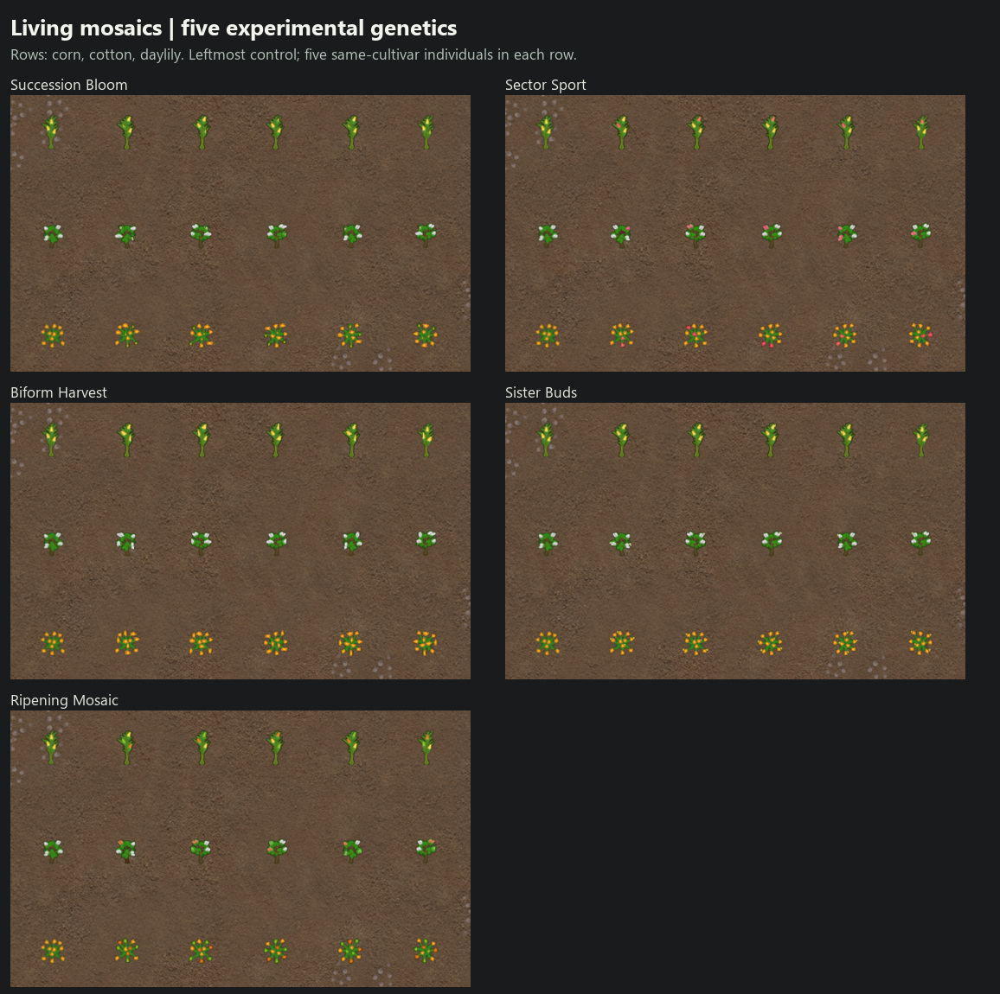

# Horticulture - Living mosaics

Native RimWorld 1.7.5014 rev1195, AllPerformance run
6ba33ad75b3342c9b5dfd1f26f08b84e, source
[2fb821f9a20a802574f5dbe3b1de2fc236ac7de4](https://github.com/lanwoodall423/Horticulture---Novel-Seeds/commit/2fb821f9a20a802574f5dbe3b1de2fc236ac7de4).

In each trait plot, the leftmost plant in each species row is vanilla;
the other five share one actual registered cultivar (not five separately
authored genetics). The shader uses native plant mesh UV.z to select an
organ-level expression variant from a shared atlas.

## Five experiments

| Candidate | Actual native close-ups | Untouched screenshot |
|---|---|---|
| Succession Bloom | [Bud and open-organ mixture](mosaic-succession-bloom.jpg) | [PNG](panel-1.png) |
| Sector Sport | [Localized rose-colored sport](mosaic-sector-sport.jpg) | [PNG](panel-2.png) |
| Biform Harvest | [Stout and slender organs](mosaic-biform-harvest.jpg) | [PNG](panel-3.png) |
| Sister Buds | [Adjacent daughter buds](mosaic-sister-buds.jpg) | [PNG](panel-4.png) |
| Ripening Mosaic | [Local green/ripe/late pigment](mosaic-ripening-mosaic.jpg) | [PNG](panel-5.png) |

Species comparison: [Corn](mosaic-corn.jpg) | [Cotton](mosaic-cotton.jpg) |
[Daylily](mosaic-daylily.jpg).

All eight native stages passed. 90 unique mature plants, 15 vanilla
controls and 75 modified plants, five replicate individuals of the same
cultivar per species and allele. All cases rendered. Native mesh payload
verified on every emitted quad and remained stable on forced remesh.
Every species/trait group selected at least two different frame slots,
and each panel verified shared materials carrying different mesh seeds.
30 shared materials and 30 prewarmed atlases across six source variations;
240 non-neutral slots passed source-alpha and changed-organ checks.
Each atlas has at least two unique non-neutral outputs; eight slots do not
imply eight distinct appearances for every source. Exact original pose
in frame zero passed 30 positional GPU orientation comparisons, plus nine
synthetic frame-index swatches. Both builds clean and 132 additional CPU
rule checks passed. All player preservation/cleanup checks passed.

Source anatomy approximate; each variant reserves native organs and only
changes selected components. Sector Sport and Ripening Mosaic are most
visible across species; Succession Bloom especially readable on daylily.
Sister Buds and Biform Harvest are relatively subtle. Inspecting all three
species close-ups confirmed upright plants. No plant pixels retouched.
Crop art, native source subvariation and horizontal flip also differ
between individuals.

These are static developmental-looking mosaics at maturity, not actual
growth timelines, somatic genetic mutations, additional harvests, or
inherited instance patterns. No mechanical impact. No new per-instance
materials or texture creation during Print. Ordinary activation,
save/reload, combined effects, other species and dense-field performance
remain unqualified. Previous approved systems retained.

[Mosaic native mesh inventory](mosaic-inventory.tsv) |
[Prepared variant checks](mosaic-preparation.tsv) |
[Genetics inventory](garden-inventory.tsv) |
[Orientation parity](orientation-parity.tsv) |
[Frame parity](gpu-frame-parity.tsv) |
[Preservation](preservation-result.json).

Reproduce with RimWorld closed:

    powershell.exe -NoProfile -ExecutionPolicy Bypass -File DevTools/Run-NativeQuicktest.ps1 -Loadout AllPerformance -MosaicGarden