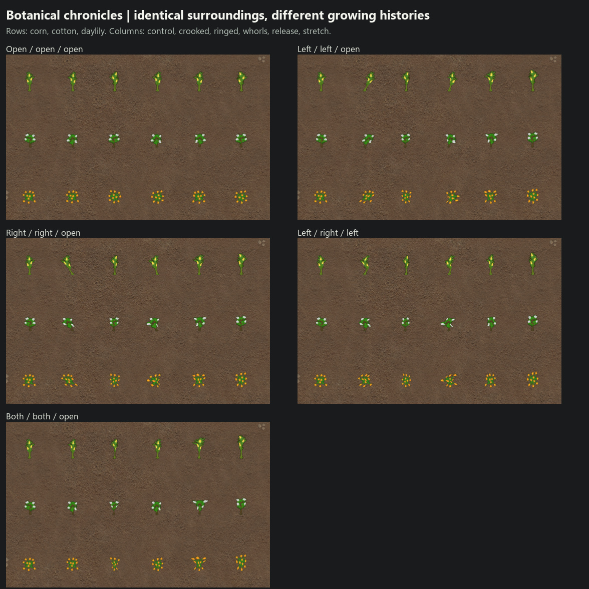

# Botanical chronicles: growth history becomes architecture

Native RimWorld 1.7.5014 rev1195, AllPerformance run
d5c47558b71a40cb9d0f7b0e8524ba0f, source
[d4c1f005b3b07f84bdd688c162f6ce7117f083ed](https://github.com/lanwoodall423/Horticulture---Novel-Seeds/commit/d4c1f005b3b07f84bdd688c162f6ce7117f083ed).

[Corn](chronicle-corn.jpg) | [Cotton](chronicle-cotton.jpg) |
[Daylily](chronicle-daylily.jpg)

Columns: vanilla control, Crooked Chronicle, Ringed Habit,
Asymmetric Whorls, Release Crown, Stretch Bands. Five groups of mature
plants with the same registered cultivar for each species/trait pair.
All are captured in identical empty plots at full growth, using the same
positions. Early, middle and late growth thresholds record the actual
lateral plants present at those moments. The fixture advances growth via
the real setter, not days of simulated cultivation.

Original captures: [Open/open/open](panel-1.png) |
[Left/left/open](panel-2.png) | [Right/right/open](panel-3.png) |
[Left/right/left](panel-4.png) | [Both/both/open](panel-5.png).

All eight native stages passed. 90 unique plants, 15 vanilla controls,
75 experimental plants, 225 first-crossing growth observations and 75
native Scribe value roundtrips. The same 15 registered cultivars are
reused across all five histories. All roots anchored; 75 grid prints,
6,075 vertices, original materials and textures. Both builds and geometry
rules passed. Normal saves, config, preferences unchanged; temporary
game process/package removed.

History is packed in a bounded integer in the plant component, observed
at 40%, 65%, and 90% growth. The standalone Scribe roundtrip exercises the
same value serializer as the component; it is not a full colony reload.
History is not rewritten by mature neighbor changes. Crooked Chronicle
is especially readable on corn; compressed/later-release profiles are
subtler. This is historical morphology of the whole sprite grid, not a
physical simulation of stems or tissue growth. The fixture is opt-in.
Natural long-duration growth, TickLong observation parity, full
save/reload, other directions, combination and dense-field performance
remain to be qualified.

[Native history and mesh inventory](chronicle-inventory.tsv) |
[Plant inventory](garden-inventory.tsv) |
[Preservation](preservation-result.json).

Comparison images are labeled crops of unretouched game screenshots.

Reproduce with RimWorld closed:

    powershell.exe -NoProfile -ExecutionPolicy Bypass -File DevTools/Run-NativeQuicktest.ps1 -Loadout AllPerformance -ChronicleGarden