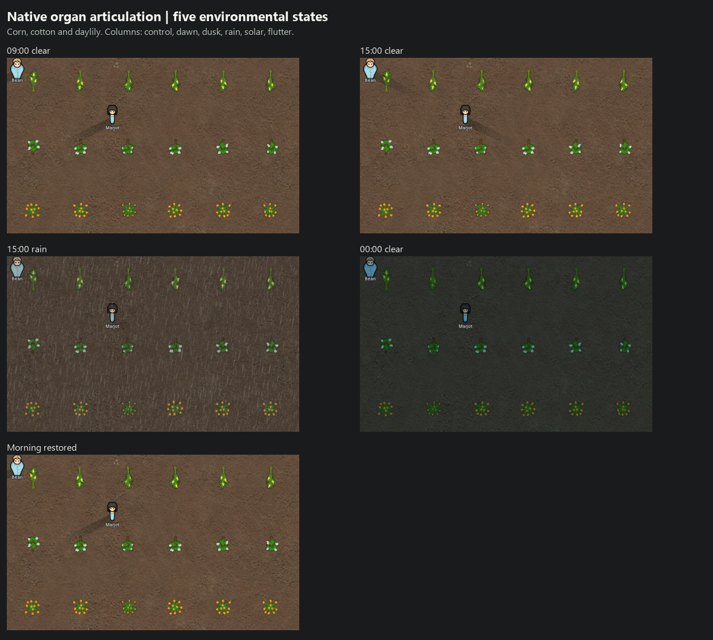

# Horticulture - independent reproductive organ articulation

Actual RimWorld 1.7.5014 rev1195, AllPerformance run
a329212d9dca4a179f09b8fc81c90c4e, source
[bbf4da99caa352b7542589e9ee2bd5dd632e1a9d](https://github.com/lanwoodall423/Horticulture---Novel-Seeds/commit/bbf4da99caa352b7542589e9ee2bd5dd632e1a9d).



| Same individuals through five states | Labeled close-ups |
|---|---|
| Corn | [Corn](articulation-corn.jpg) |
| Cotton | [Cotton](articulation-cotton.jpg) |
| Daylily | [Daylily](articulation-daylily.jpg) |

Original 1600x900 in-game captures:
[Morning](panel-1.png) | [Afternoon](panel-2.png) |
[Rain](panel-3.png) | [Midnight](panel-4.png) | [Restored morning](panel-5.png).

All eight native stages passed; 18 unique mature plants, three vanilla
controls, 15 registered experimental cultivars, all rendered, no fallback.
Five environmental states, 75 verified material/control states, 15 stable
materials, 30 prepared nine-frame atlases, six original source variations.
Native wind manager phase advanced and selected different local organ frames.
All 30 atlases retained the original source alpha footprint and at least one
exact source frame. No new geometry, manual masks, or GPU phenotype masks.
Initial ordinary and fixture builds clean; all prior and 20 new rules passed.
All preservation and cleanup checks passed.

The atlas uses approximate pigment-based reproductive components and local
foliage reconstruction; source alpha retention can leave reconstructed
foliage silhouettes where a contracted organ was. The effects are subtle
at normal zoom; original source variants and wind motion complicate direct
comparisons with controls. Midnight/rain further reduce visibility.
This run verified material phase, actual scene rendering, and all nine GPU frame indices; smooth natural motion remains unqualified. It is not an
art-direction approval or production release. No plant pixels retouched;
the labeled crops are enlarged from the original captures.

[Native material/frame inventory](articulation-inventory.tsv) |
[Atlas preparation](articulation-preparation.tsv) |
[Genetics inventory](garden-inventory.tsv) |
[Player preservation](preservation-result.json).

Reproduce with the game closed:
```powershell
powershell.exe -NoProfile -ExecutionPolicy Bypass -File DevTools/Run-NativeQuicktest.ps1 -Loadout AllPerformance -ArticulationGarden
```
## GPU orientation regression

The initial native garden passed material checks, but the follow-up swatch probe
(run a0e0a175ebf14d5aa7771a58e5fecbfb) found outer atlas rows reversed.
Corrected source bbf4da9 passed all nine swatches with maximum normalized RGB
error 0.0018627644, then passed all eight garden stages again.
[Before fix](gpu-parity-before-fix.tsv) | [After fix](gpu-parity-corrected.tsv).