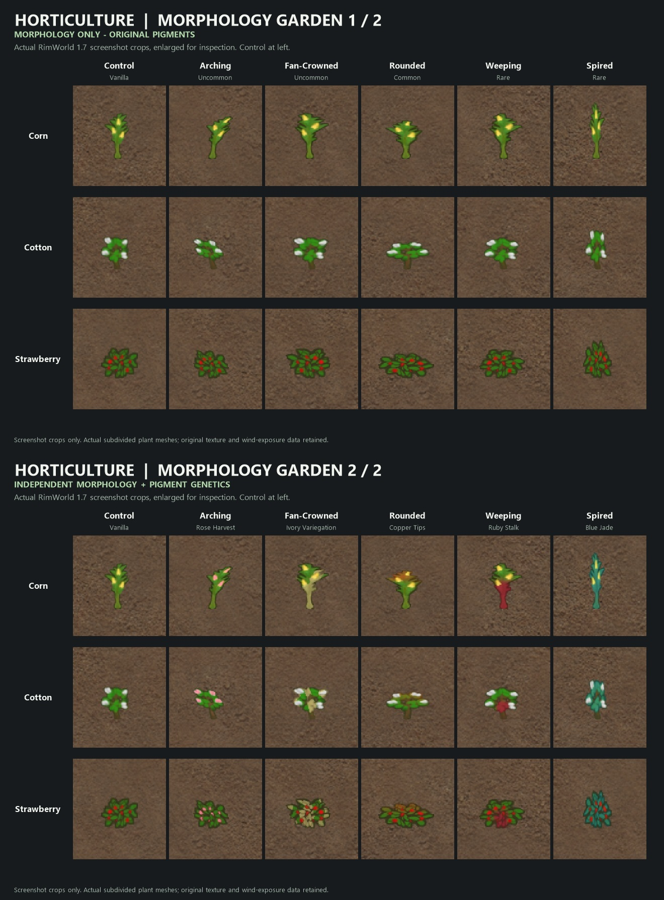

# Horticulture - genetic plant morphology technology proof

Actual RimWorld 1.7.5014 rev1195, AllPerformance run 688f88b8428747af8fc456fbd10000ec,
source 607690ec5e5ab4ddaa72262b84d29b016bae9a4a.

| Plot | Labeled close-ups | Unedited screenshot |
|---|---|---|
| Morphology only, original pigments | [1](form-plot-1.jpg) | [PNG](panel-1.png) |
| Morphology plus independent pigmentation | [2](form-plot-2.jpg) | [PNG](panel-2.png) |

36 plants, 30 registered form cultivars and 6 vanilla controls.
Five forms (Arching, Fan-Crowned, Rounded, Weeping, Spired) on corn, cotton,
strawberry, both alone and combined respectively with Rose Harvest, Ivory
Variegation, Copper Tips, Ruby Stalk, Blue Jade. Five native stages passed.
30 actual deformed mesh prints, 750 vertices, 960 triangles. Each deformed
plane has 25 vertices and 32 triangles. All 15 form-only cultivars retained
the original material path (zero custom shader materials in plot 1); all 15
combined cultivars used the mask-free pigment GPU path. Zero prepared masks.
Two actual noon screenshots, sky glow 1. No relevant HNS error identified.
All cleanup and player preservation checks passed.

This method deforms a subdivided 2D plant sprite mesh at section construction;
it is not new leaf geometry or 3D anatomy. Vanilla UV, altitude and wind color
data are retained; temporal animation behavior has not been separately measured.
The original bottom row stays anchored; geometry checks at maximum strength
passed for both flips. Mesh cost increases, and snow/independent mask geometry
are outside this prototype. Existing phenotype shader fallback remains intact.
Form alleles are experimental, zero default mutation weight; no mechanical
traits, normal saves or legacy 1.6 content changed. No production activation,
field performance, editor, natural inheritance or save/reload qualification.

[Exact per-plant genetic and renderer inventory](garden-inventory.tsv).
