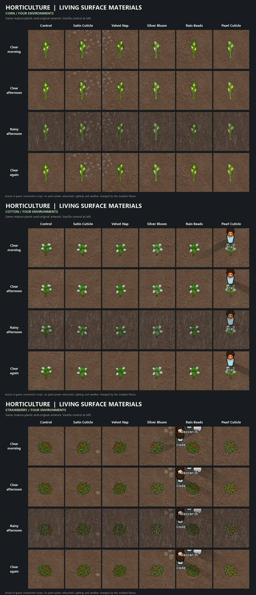

# Horticulture - environment-responsive surface materials

Actual RimWorld 1.7.5014 rev1195, AllPerformance run d954993b2d4f4e5a92e968cb2c1f1c8d,
source 84d0d06e04a82b7b366e910f52e89005a29f4a89.

| Species | Four environmental states |
|---|---|
| Corn | [Comparison](surface-corn.jpg) |
| Cotton | [Comparison](surface-cotton.jpg) |
| Strawberry | [Comparison](surface-strawberry.jpg) |

18 same mature plants, 15 cultivars and three controls, at fixed positions.
Clear 09:00, clear 15:00, rainy 15:00, clear 15:00 again. Actual map weather
and local solar time changed by the fixture. Sky glow remained 1 in all four
captures; the visual variable is directional response and rain, not a test
of changing light intensity. All seven stages passed; 60 verified surface
material/environment states, 15 materials throughout, zero prepared masks.
Both builds and rule tests passed. Player preservation and cleanup passed.

Five independent cosmetic alleles: Satin Cuticle, Velvet Nap, Silver Bloom,
Rain Beads and Pearl Cuticle. The shader estimates relief from neighboring
source luminance, not actual normals. Rain uses native rain rate; sheltered
materials suppress the wetness uniform at preparation, but roof changes
and shelter behavior have not been separately qualified.

The effects are deliberately restrained; silver/waxy and pearlescent foliage
are more readable in the corn comparison. Beads are hard to distinguish
under the vanilla rain overlay at normal zoom. Some pawn labels appear in
the strawberry comparison. No plant pixels retouched. No physical water
simulation, actual scene-light integration or new artwork. Ordinary activation,
continuous natural weather transitions, combinations and performance unqualified.
Prior visual experiments retained; no balance changes.

[Material/environment evidence](surface-inventory.tsv) | [Genetic inventory](garden-inventory.tsv).

Untouched captures: [morning](panel-1.png), [afternoon](panel-2.png), [rain](panel-3.png), [clear again](panel-4.png).
