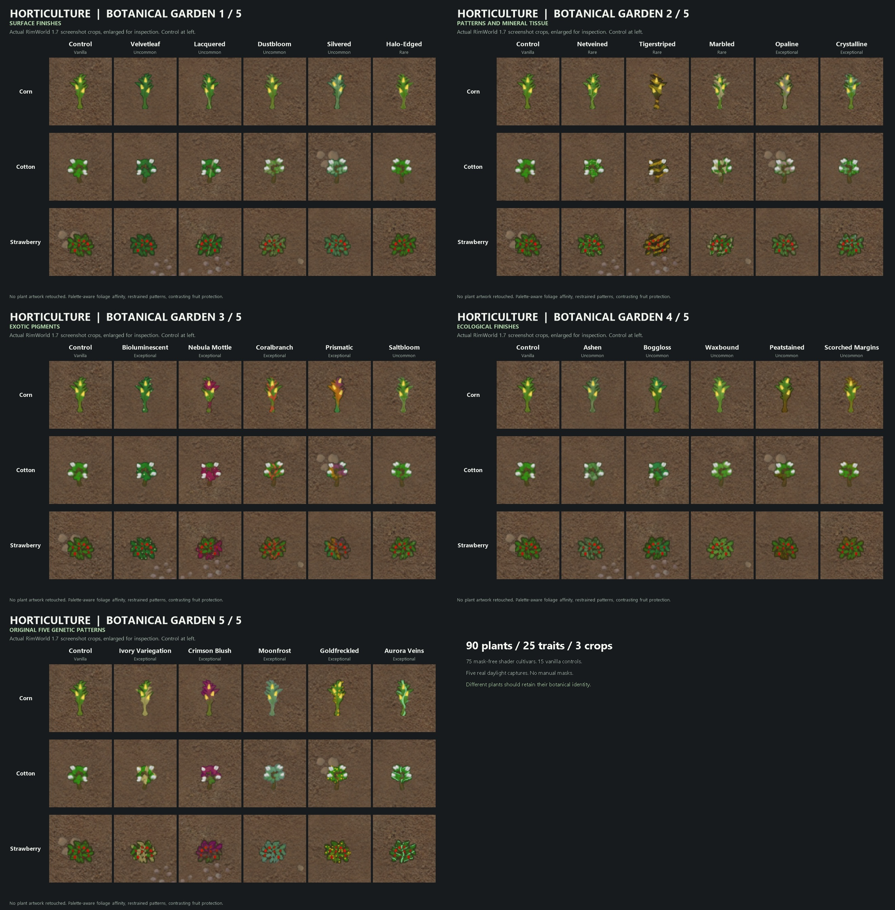

# Horticulture - botanical refinement garden

Actual RimWorld 1.7.5014 rev1195 captures, AllPerformance run
6b22c5f4e58c4701b2202c4caf2d4444, source 5dd60e5cbe3a5abfeb9cabbc1030b8c327d45b6d.

| Plot | Refined close-ups | Before / after | Unedited screenshot |
|---|---|---|---|
| Surface finishes | [1](botanical-plot-1.jpg) | [Compare](comparison-1.jpg) | [PNG](panel-1.png) |
| Patterns and mineral tissue | [2](botanical-plot-2.jpg) | [Compare](comparison-2.jpg) | [PNG](panel-2.png) |
| Exotic pigments | [3](botanical-plot-3.jpg) | [Compare](comparison-3.jpg) | [PNG](panel-3.png) |
| Ecological finishes | [4](botanical-plot-4.jpg) | [Compare](comparison-4.jpg) | [PNG](panel-4.png) |
| Original five procedural traits | [5](botanical-plot-5.jpg) | [Prior separate garden](https://github.com/lanwoodall423/Horticulture---Novel-Seeds/tree/e4040974f395eb1d845c95894f31fcfc2debe786) | [PNG](panel-5.png) |

90 actual plants; 75 registered single-trait cultivars, 15 controls.
Every one of the 25 explicit procedural motifs on corn, cotton and strawberry.
All eight stages passed; 75/75 mask-free GPU cultivars; zero prepared mask textures.
No relevant Horticulture errors identified. All preservation/cleanup checks passed.

The first naturalistic pass (3012adf, run 23b407b415714f90a7517c41f918cabd)
was too subdued in visual review. This final iteration restores stronger local
foliage contrast while protecting contrasting produce, pale flowers and shadows.
The shader uses continuous source-color affinity and irregular expression, not
precise anatomy. Existing automatic regions take priority if already active.
All 25 traits remain cosmetic, zero-default-weight experimental candidates.
No gameplay weights, mechanics or historical 1.6 assets changed.

Before images from the previous 4ff1cbbf51664e3994dc11de929aad8c creative garden.
Same species and trait assignments, different randomized maps and plant instances.
Qualitative comparison, not pixel-matched. Images cropped/enlarged, no plant
artwork retouched. Some subtle motifs remain difficult to see at normal zoom.
Other plant palettes, regional combinations, growth stages, harvested items,
editor previews, performance and production shader activation still need qualification.

[Exact per-plant inventory](garden-inventory.tsv).
